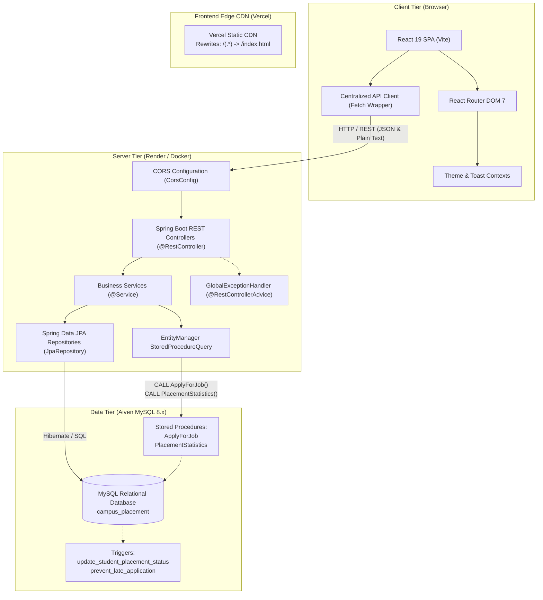

# Campus Placement Management System — Long-Term Project Progress & Codebase Audit

> **Document Status**: Production Verified Codebase Audit  
> **Last Updated**: 2026-10-30  
> **Target Audience**: Software Engineers & AI Assistants continuing system development  

---

## 1. Project Overview

### 1.1 Project Purpose
The **Campus Placement Management System** is a decoupled full-stack university placement automation platform designed to manage the end-to-end higher education campus recruitment lifecycle. It digitizes student records, corporate partner registries, job postings, automated academic eligibility verification, application tracking, multi-round interview schedules, final placement records, and department-level placement analytics.

### 1.2 Main Users & Intended Roles
Based on the design specifications in [Project_Requirements.md](file:///e:/Github%20Repo/placement-management-system/docs/Project_Requirements.md) and the finalized three-role security architecture (Task 0.2.1A):
- **Students (`ROLE_STUDENT`)**: Browse verified job opportunities and partner companies, verify academic eligibility, apply for jobs, track personal application progress, view personal interview schedules/results, view placement offers, and monitor department statistics. Strictly isolated to their own student records.
- **Placement Officers (`ROLE_PLACEMENT_OFFICER`)**: Manage student academic records in roster, onboard corporate partners, post recruitment drives, supervise application screening and shortlisting, schedule interview rounds, update interview outcomes, record final placement offers, and monitor department analytics. Restricted from user account and role management.
- **Administrators (`ROLE_ADMIN`)**: Overall system administration, user account lifecycle governance (create, enable/disable accounts), role assignment, provisioning and onboarding of Placement Officer accounts, with full access to all placement operations.

*(Note on Current Access Model: While three distinct roles are finalized in architecture specifications, the current codebase does not yet implement authentication or access controls. All views and API endpoints are currently accessible without authentication).*

### 1.3 Actual Technology Stack
The verified technology stack derived directly from package manifests and project configuration files:

| Layer | Declared Technology | Actual Verified Version & Details | Primary Config File |
| :--- | :--- | :--- | :--- |
| **Frontend Framework** | React (SPA) | **React 19.2.8**, **React DOM 19.2.8** | [package.json](file:///e:/Github%20Repo/placement-management-system/frontend/package.json) |
| **Frontend Tooling** | Vite | **Vite 8.3.4**, **@vitejs/plugin-react 6.1.1** | [vite.config.js](file:///e:/Github%20Repo/placement-management-system/frontend/vite.config.js) |
| **Frontend Routing** | React Router | **React Router DOM 7.18.4** | [App.jsx](file:///e:/Github%20Repo/placement-management-system/frontend/src/App.jsx) |
| **Frontend UI & Icons** | Vanilla CSS & Lucide | **Lucide React 1.55.0**, Custom CSS Token Design System | [variables.css](file:///e:/Github%20Repo/placement-management-system/frontend/src/styles/variables.css) |
| **Frontend Charts** | Recharts | **Recharts 3.10.1** | [DashboardPage.jsx](file:///e:/Github%20Repo/placement-management-system/frontend/src/pages/DashboardPage.jsx) |
| **Frontend Linter** | Oxlint | **Oxlint 1.81.0** | [.oxlintrc.json](file:///e:/Github%20Repo/placement-management-system/frontend/.oxlintrc.json) |
| **Backend Framework** | Spring Boot | **Spring Boot 4.1.1** (Spring Web MVC, Spring Data JPA, Validation) | [pom.xml](file:///e:/Github%20Repo/placement-management-system/backend/pom.xml) |
| **Backend Runtime** | Java | **Java 17** (compiled with Maven Wrapper 3.9.9) | [pom.xml](file:///e:/Github%20Repo/placement-management-system/backend/pom.xml) |
| **Relational Database** | MySQL | **MySQL 8.0+** (InnoDB engine, Stored Procedures, Triggers) | [schema.sql](file:///e:/Github%20Repo/placement-management-system/database/schema.sql) |
| **Database Driver** | MySQL Connector/J | **com.mysql:mysql-connector-j** (Runtime dependency) | [pom.xml](file:///e:/Github%20Repo/placement-management-system/backend/pom.xml) |
| **Connection Pool** | HikariCP | Managed by Spring Boot Starter Data JPA | [application.properties](file:///e:/Github%20Repo/placement-management-system/backend/src/main/resources/application.properties) |
| **Containerization** | Docker | Multi-stage Dockerfile (`eclipse-temurin:17-jre-alpine`) | [Dockerfile](file:///e:/Github%20Repo/placement-management-system/backend/Dockerfile) |

### 1.4 Repository Structure
The repository is structured as a multi-root monorepo containing distinct decoupled components:
- `backend/`: Java Spring Boot REST API service, Maven wrapper, and Docker container definition.
- `frontend/`: React 19 Single Page Application built with Vite.
- `database/`: Raw DDL schemas, seed data SQL, stored procedures, triggers, and analytical queries.
- `docs/`: Relational mapping documentation, ER diagrams, and system requirements.

### 1.5 Discoverable Deployment URLs
Verified from [README.md](file:///e:/Github%20Repo/placement-management-system/README.md) and [DECISION.md](file:///e:/Github%20Repo/placement-management-system/DECISION.md):
- **Live Frontend Application (Vercel CDN)**: `https://placement-management-system-kappa.vercel.app/`
- **Cloud Backend Platform Target**: Render Web Service (Docker runtime, dynamic `$PORT`, health path `/api/health`).
- **Cloud Database Target**: Aiven for MySQL (Encrypted TLS connection, `sslMode=REQUIRED`).

---

## 2. Current Project Status

### 2.1 Overall Implementation Summary
The project features a working, fully responsive frontend UI connected to a Spring Boot REST API backed by MySQL. Stored procedures and triggers handle complex application eligibility checking and department statistics. Core entity creation, filtering, deletion, and cross-entity viewing are functional across all modules.

However, the application currently lacks authentication/authorization, entity update (PUT/PATCH) workflows, auto-incrementing ID sequences in MySQL/JPA, automated unit/integration tests that run without external infrastructure, and a dedicated UI view for academic department management.

### 2.2 Feature Status Matrix

| Module / Feature | Status | Summary Evidence |
| :--- | :--- | :--- |
| **System Dashboard & Global Metrics** | **COMPLETE** | Client-side aggregated metrics, Recharts application breakdown donut, department student distribution bar chart, recent items tables in [DashboardPage.jsx](file:///e:/Github%20Repo/placement-management-system/frontend/src/pages/DashboardPage.jsx). |
| **Student Directory & Profile Creation** | **PARTIAL** | View modal, delete action, create student form (manual ID), search, and department/status filters in [StudentsPage.jsx](file:///e:/Github%20Repo/placement-management-system/frontend/src/pages/StudentsPage.jsx). Edit/update is not implemented. |
| **Corporate Partner Management** | **PARTIAL** | View modal with associated company job openings, delete action, create company form (manual ID), search, and industry filters in [CompaniesPage.jsx](file:///e:/Github%20Repo/placement-management-system/frontend/src/pages/CompaniesPage.jsx). Edit/update is not implemented. |
| **Job Opportunities & Listings** | **PARTIAL** | Job listing cards/tables, active/expired deadline filters, package formatting in LPA, delete action, create job form in [JobsPage.jsx](file:///e:/Github%20Repo/placement-management-system/frontend/src/pages/JobsPage.jsx). Edit/update is not implemented. |
| **Eligibility Verification Workflow** | **COMPLETE** | Interactive student eligibility validation handled via stored procedure `ApplyForJob` and trigger `prevent_late_application`. |
| **Job Application Submission & Tracking** | **PARTIAL** | Stored procedure application submission from Jobs page, manual application entry and deletion in [ApplicationsPage.jsx](file:///e:/Github%20Repo/placement-management-system/frontend/src/pages/ApplicationsPage.jsx). Status lifecycle progression buttons and edit endpoints are missing. |
| **Multi-Round Interview Management** | **PARTIAL** | Schedule tracking, upcoming/completed tabs, round type filter, creation and deletion in [InterviewsPage.jsx](file:///e:/Github%20Repo/placement-management-system/frontend/src/pages/InterviewsPage.jsx). Round result progression and interview update are not implemented. |
| **Placement Outcome & Offer Recording** | **PARTIAL** | Offer creation and listing in [PlacementsPage.jsx](file:///e:/Github%20Repo/placement-management-system/frontend/src/pages/PlacementsPage.jsx). Database trigger updates student status to `PLACED`. Edit/update is not implemented. |
| **Department Management** | **PARTIAL** | Backend CRUD exists in [DepartmentController.java](file:///e:/Github%20Repo/placement-management-system/backend/src/main/java/com/example/placement_management_system/controller/DepartmentController.java), but no dedicated frontend management page exists. Departments are only loaded as dropdown options. |
| **Department Placement Statistics** | **COMPLETE** | Live execution of stored procedure `PlacementStatistics` with single-department inspection and multi-department comparative visualization in [StatisticsPage.jsx](file:///e:/Github%20Repo/placement-management-system/frontend/src/pages/StatisticsPage.jsx). |
| **Theme Engine (Light & Dark Mode)** | **COMPLETE** | Context-based theme engine with localStorage persistence, system preference detection, and floating toggle in [ThemeContext.jsx](file:///e:/Github%20Repo/placement-management-system/frontend/src/contexts/ThemeContext.jsx). |
| **Cloud Health Check** | **COMPLETE** | Endpoint `GET /api/health` providing service status and timestamp in [HealthController.java](file:///e:/Github%20Repo/placement-management-system/backend/src/main/java/com/example/placement_management_system/controller/HealthController.java). |
| **Authentication & Role-Based Access Control** | **IN PROGRESS (FOUNDATION COMPLETE)** | Security foundation implemented (Task 0.2.2): Spring Security, JJWT 0.12.6, Role enum (3 roles), AppUser entity, AppUserRepository, JwtService, auth_schema.sql, passing test suite (9 tests). Endpoints, filter chain, and UI pending. |
| **Entity Editing / Modification (PUT/PATCH)** | **NOT IMPLEMENTED** | Neither the backend controllers nor the frontend API clients and forms provide update/edit functionality. |
| **Automated Unit & Integration Test Suite** | **PARTIAL / OPERATIONAL** | In-memory H2 test profile configured via `application-test.properties` and `@ActiveProfiles("test")`. `PlacementManagementSystemApplicationTests.contextLoads` passes with exit code 0. Stored procedures and triggers require dedicated MySQL integration testing. |

### 2.3 Verified Build, Test, and Quality Status
- **Frontend Linter (`npm run lint`)**: **PASS** (0 errors, 57 code style/effect warnings from Oxlint).
- **Frontend Production Build (`npm run build`)**: **PASS** (Exit code 0, 2526 modules bundled via Vite into `dist/` in 1.69s).
- **Backend Clean Compilation (`mvnw compile`)**: **PASS** (Exit code 0, all 38 Java classes compiled with Java 17).
- **Backend Test Suite (`mvnw test`)**: **PASS** (Exit code 0, 1 test run, 0 failures, 0 errors in ~9.8s using test profile with in-memory H2 database `jdbc:h2:mem:campus_placement;MODE=MySQL`).
- **Live Deployment State**: Frontend is deployed and accessible on Vercel at `https://placement-management-system-kappa.vercel.app/`.

---

## 3. Codebase Architecture

### 3.1 Architectural Diagram



### 3.2 Frontend Entry Point & Routing
- **Entry Point**: [index.html](file:///e:/Github%20Repo/placement-management-system/frontend/index.html) loads Google Fonts (Inter) and mounts [main.jsx](file:///e:/Github%20Repo/placement-management-system/frontend/src/main.jsx) into `#root`.
- **Root Component**: [App.jsx](file:///e:/Github%20Repo/placement-management-system/frontend/src/App.jsx) wraps the entire application with `ThemeProvider` and `ToastProvider`.
- **Layout Shell**: [AppLayout.jsx](file:///e:/Github%20Repo/placement-management-system/frontend/src/components/layout/AppLayout.jsx) renders the persistent collapsible [Sidebar.jsx](file:///e:/Github%20Repo/placement-management-system/frontend/src/components/layout/Sidebar.jsx), [TopHeader.jsx](file:///e:/Github%20Repo/placement-management-system/frontend/src/components/layout/TopHeader.jsx), and [FloatingThemeToggle.jsx](file:///e:/Github%20Repo/placement-management-system/frontend/src/components/common/FloatingThemeToggle.jsx), nesting pages via `<Outlet />`.
- **Client-Side Routes**:
  - `/` → [DashboardPage.jsx](file:///e:/Github%20Repo/placement-management-system/frontend/src/pages/DashboardPage.jsx)
  - `/students` → [StudentsPage.jsx](file:///e:/Github%20Repo/placement-management-system/frontend/src/pages/StudentsPage.jsx)
  - `/companies` → [CompaniesPage.jsx](file:///e:/Github%20Repo/placement-management-system/frontend/src/pages/CompaniesPage.jsx)
  - `/jobs` → [JobsPage.jsx](file:///e:/Github%20Repo/placement-management-system/frontend/src/pages/JobsPage.jsx)
  - `/applications` → [ApplicationsPage.jsx](file:///e:/Github%20Repo/placement-management-system/frontend/src/pages/ApplicationsPage.jsx)
  - `/interviews` → [InterviewsPage.jsx](file:///e:/Github%20Repo/placement-management-system/frontend/src/pages/InterviewsPage.jsx)
  - `/placements` → [PlacementsPage.jsx](file:///e:/Github%20Repo/placement-management-system/frontend/src/pages/PlacementsPage.jsx)
  - `/statistics` → [StatisticsPage.jsx](file:///e:/Github%20Repo/placement-management-system/frontend/src/pages/StatisticsPage.jsx)
  - `*` → Redirects to `/`

### 3.3 Backend Entry Point & Request Flow
- **Application Boot**: [PlacementManagementSystemApplication.java](file:///e:/Github%20Repo/placement-management-system/backend/src/main/java/com/example/placement_management_system/PlacementManagementSystemApplication.java) annotates standard `@SpringBootApplication`.
- **CORS Handling**: [CorsConfig.java](file:///e:/Github%20Repo/placement-management-system/backend/src/main/java/com/example/placement_management_system/config/CorsConfig.java) reads the environment variable `cors.allowed-origins` (defaulting to `http://localhost:5173`), registers allowed origins on `/api/**`, and permits `GET`, `POST`, `PUT`, `DELETE`, `OPTIONS`.
- **Error Handling**: [GlobalExceptionHandler.java](file:///e:/Github%20Repo/placement-management-system/backend/src/main/java/com/example/placement_management_system/exception/GlobalExceptionHandler.java) intercepts `DataAccessException` to capture stored procedure error signals (such as duplicate applications or constraint violations) and converts them into appropriate HTTP status codes (e.g. `409 CONFLICT` or `400 BAD_REQUEST`).

### 3.4 API Communication Model
- Frontend requests are centralized in [client.js](file:///e:/Github%20Repo/placement-management-system/frontend/src/api/client.js).
- Target URL is dynamically configured via `import.meta.env.VITE_API_BASE_URL` (falling back to `http://localhost:8080/api`).
- Parsing is resilient: responses are read via `response.text()` first, safely parsed to JSON when valid, and preserved as plain text when the server returns unquoted text (resolving syntax parsing issues with Spring string converters).
- Cold start detection: when `fetch` throws a network error, a clear warning is surfaced indicating that cloud containers (e.g. Render free tier) may require 30–60 seconds to spin up from sleep.

---

## 4. Directory and File Guide

```text
placement-management-system/
├── backend/                                  # Spring Boot Application Root
│   ├── .dockerignore                         # Excludes target and source artifacts from Docker context
│   ├── Dockerfile                            # Multi-stage Java 17 container build for cloud deployment
│   ├── mvnw / mvnw.cmd                       # Maven wrapper scripts
│   ├── pom.xml                               # Maven project dependencies and plugins
│   └── src/
│       ├── main/
│       │   ├── java/com/example/placement_management_system/
│       │   │   ├── PlacementManagementSystemApplication.java # Spring Boot main entry class
│       │   │   ├── config/
│       │   │   │   └── CorsConfig.java       # Cross-Origin Resource Sharing configuration
│       │   │   ├── controller/               # REST API Controllers (@RestController)
│       │   │   │   ├── ApplicationController.java
│       │   │   │   ├── CompanyController.java
│       │   │   │   ├── DepartmentController.java
│       │   │   │   ├── HealthController.java # Lightweight /api/health endpoint
│       │   │   │   ├── InterviewController.java
│       │   │   │   ├── JobController.java
│       │   │   │   ├── PlacementController.java
│       │   │   │   ├── PlacementProcedureController.java # Procedure execution for job application
│       │   │   │   ├── PlacementStatisticsController.java# Procedure execution for department statistics
│       │   │   │   └── StudentController.java
│       │   │   ├── entity/                   # JPA Entity Models (@Entity)
│       │   │   │   ├── Application.java
│       │   │   │   ├── Company.java
│       │   │   │   ├── Department.java
│       │   │   │   ├── Interview.java
│       │   │   │   ├── Job.java
│       │   │   │   ├── Placement.java
│       │   │   │   └── Student.java
│       │   │   ├── exception/
│       │   │   │   └── GlobalExceptionHandler.java # @RestControllerAdvice for database/parameter errors
│       │   │   ├── repository/               # Spring Data JPA Repositories
│       │   │   │   ├── ApplicationRepository.java
│       │   │   │   ├── CompanyRepository.java
│       │   │   │   ├── DepartmentRepository.java
│       │   │   │   ├── InterviewRepository.java
│       │   │   │   ├── JobRepository.java
│       │   │   │   ├── PlacementProcedureRepository.java # @Procedure annotated JPA repository
│       │   │   │   ├── PlacementRepository.java
│       │   │   │   ├── PlacementStatisticsRepository.java# EntityManager-based stored procedure runner
│       │   │   │   └── StudentRepository.java
│       │   │   └── service/                  # Business Logic Layer (@Service)
│       │   │       ├── ApplicationService.java
│       │   │       ├── CompanyService.java
│       │   │       ├── DepartmentService.java
│       │   │       ├── InterviewService.java
│       │   │       ├── JobService.java
│       │   │       ├── PlacementProcedureService.java
│       │   │       ├── PlacementService.java
│       │   │       ├── PlacementStatisticsService.java
│       │   │       └── StudentService.java
│       │   └── resources/
│       │       ├── application.properties    # Environment-variable backed configuration
│       │       └── application.properties.example # Developer template for local MySQL / Aiven
│       └── test/
│           ├── java/com/example/placement_management_system/
│           │   └── PlacementManagementSystemApplicationTests.java # ContextLoads test configured with @ActiveProfiles("test")
│           └── resources/
│               └── application-test.properties # Dedicated H2 in-memory test configuration (MODE=MySQL, ddl-auto=create-drop)
├── database/                                 # Database Scripts & Automation
│   ├── data.sql                              # Seed records for all 7 relational tables
│   ├── procedures_triggers.sql               # Stored procedures (ApplyForJob, PlacementStatistics) & triggers
│   ├── queries.sql                           # Verification, aggregate, and reporting SQL queries
│   └── schema.sql                            # DDL statements for campus_placement schema and tables
├── docs/                                     # Documentation & Design Specifications
│   ├── database_requirements.md              # Functional specifications for database schema and procedures
│   ├── ER_Diagram_Placement_System.png       # Entity Relationship graphical diagram
│   ├── ER_to_Relational_Mapping.md           # Formal mapping of ER constructs to relational tables
│   └── Project_Requirements.md               # Original product requirements and feature scope
├── frontend/                                 # React Frontend Single Page Application
│   ├── .env.example                          # Example environment variables (VITE_API_BASE_URL)
│   ├── .oxlintrc.json                        # Oxlint configuration
│   ├── index.html                            # HTML template entry with Google Inter font
│   ├── package.json                          # NPM dependencies (React 19, Vite, Recharts, Lucide)
│   ├── public/
│   │   └── _redirects                        # SPA redirect rule for Netlify/Render Static
│   ├── src/
│   │   ├── App.jsx                           # Application router and context wrapper
│   │   ├── index.css                         # Global CSS resets
│   │   ├── main.jsx                          # React DOM client mount point
│   │   ├── api/                              # Centralized HTTP API services
│   │   │   ├── applications.js
│   │   │   ├── client.js                     # Core fetch client with plain-text resilience
│   │   │   ├── companies.js
│   │   │   ├── departments.js
│   │   │   ├── interviews.js
│   │   │   ├── jobs.js
│   │   │   ├── placements.js
│   │   │   ├── procedures.js                 # Procedures API client (applyForJob, getPlacementStatistics)
│   │   │   └── students.js
│   │   ├── components/
│   │   │   ├── common/                       # Reusable UI widgets
│   │   │   │   ├── Button.jsx
│   │   │   │   ├── Card.jsx
│   │   │   │   ├── ConfirmDialog.jsx
│   │   │   │   ├── EmptyState.jsx
│   │   │   │   ├── ErrorState.jsx
│   │   │   │   ├── FloatingThemeToggle.jsx
│   │   │   │   ├── IconButton.jsx
│   │   │   │   ├── LoadingSkeleton.jsx
│   │   │   │   ├── MetricCard.jsx
│   │   │   │   ├── Modal.jsx
│   │   │   │   ├── Pagination.jsx
│   │   │   │   ├── SearchInput.jsx
│   │   │   │   └── StatusBadge.jsx
│   │   │   ├── forms/                        # Controlled Form Components
│   │   │   │   ├── FormInput.jsx
│   │   │   │   ├── FormSelect.jsx
│   │   │   │   └── FormTextarea.jsx
│   │   │   └── layout/                       # App Shell Components
│   │   │       ├── AppLayout.jsx
│   │   │       ├── Sidebar.jsx
│   │   │       └── TopHeader.jsx
│   │   ├── contexts/                         # React State Contexts
│   │   │   ├── ThemeContext.jsx              # Theme state with localStorage persistence
│   │   │   └── ToastContext.jsx              # Global floating toast alerts
│   │   ├── pages/                            # Routed View Pages
│   │   │   ├── ApplicationsPage.jsx
│   │   │   ├── CompaniesPage.jsx
│   │   │   ├── DashboardPage.jsx
│   │   │   ├── InterviewsPage.jsx
│   │   │   ├── JobsPage.jsx
│   │   │   ├── PlacementsPage.jsx
│   │   │   ├── StatisticsPage.jsx
│   │   │   └── StudentsPage.jsx
│   │   ├── styles/                           # Custom CSS Token Design System
│   │   │   ├── base.css
│   │   │   ├── components.css
│   │   │   ├── layout.css
│   │   │   └── variables.css
│   │   └── utils/
│   │       └── formatters.js                 # INR currency, LPA, and date formatting utilities
│   ├── vercel.json                           # Vercel SPA rewrite configuration
│   └── vite.config.js                        # Vite bundler configuration
├── .gitignore                                # Root Git exclusions (target, dist, .env, DECISION.md)
├── DECISION.md                               # Deployment architecture, bug fix records, and runbooks
├── PROJECT_PROGRESS.md                       # This comprehensive progress & audit document
└── README.md                                 # Project documentation and quickstart instructions
```

---

## 5. Feature-by-Feature Implementation Status

### 5.1 Student Management
- **Status**: **PARTIAL**
- **Frontend Implementation**: [StudentsPage.jsx](file:///e:/Github%20Repo/placement-management-system/frontend/src/pages/StudentsPage.jsx) renders a paginated table with real-time text search (name, email, ID), department dropdown filter, placement status filter, view details modal, and delete confirmation dialog. Registration modal collects `studentId`, `name`, `email`, `phone`, `departmentId`, `graduationYear`, `cgpa`, `backlogs`, and `placementStatus`.
- **Backend Implementation**: [StudentController.java](file:///e:/Github%20Repo/placement-management-system/backend/src/main/java/com/example/placement_management_system/controller/StudentController.java), [StudentService.java](file:///e:/Github%20Repo/placement-management-system/backend/src/main/java/com/example/placement_management_system/service/StudentService.java), [StudentRepository.java](file:///e:/Github%20Repo/placement-management-system/backend/src/main/java/com/example/placement_management_system/repository/StudentRepository.java). Supports `GET /api/students`, `GET /api/students/{id}`, `POST /api/students`, `DELETE /api/students/{id}`.
- **Database Implementation**: Table `student` in [schema.sql](file:///e:/Github%20Repo/placement-management-system/database/schema.sql).
- **Known Limitations & Missing Pieces**:
  1. No update/edit endpoint (`PUT /api/students/{id}`) exists; students cannot modify their profiles or updated CGPA after registration.
  2. `student_id` is an integer primary key without auto-generation (`@GeneratedValue`), requiring manual ID entry during creation.
  3. No profile picture upload or resume document attachment.

### 5.2 Corporate Partner (Company) Management
- **Status**: **PARTIAL**
- **Frontend Implementation**: [CompaniesPage.jsx](file:///e:/Github%20Repo/placement-management-system/frontend/src/pages/CompaniesPage.jsx) renders company cards/table with search, industry filter, view modal displaying company details alongside associated job openings, delete action, and create company modal.
- **Backend Implementation**: [CompanyController.java](file:///e:/Github%20Repo/placement-management-system/backend/src/main/java/com/example/placement_management_system/controller/CompanyController.java), [CompanyService.java](file:///e:/Github%20Repo/placement-management-system/backend/src/main/java/com/example/placement_management_system/service/CompanyService.java), [CompanyRepository.java](file:///e:/Github%20Repo/placement-management-system/backend/src/main/java/com/example/placement_management_system/repository/CompanyRepository.java). Supports `GET /api/companies`, `GET /api/companies/{id}`, `POST /api/companies`, `DELETE /api/companies/{id}`.
- **Database Implementation**: Table `company` in [schema.sql](file:///e:/Github%20Repo/placement-management-system/database/schema.sql).
- **Known Limitations & Missing Pieces**:
  1. No edit endpoint (`PUT /api/companies/{id}`) exists.
  2. `company_id` is not auto-incrementing; user must input a unique integer ID.

### 5.3 Job Opportunities & Drives
- **Status**: **PARTIAL**
- **Frontend Implementation**: [JobsPage.jsx](file:///e:/Github%20Repo/placement-management-system/frontend/src/pages/JobsPage.jsx) displays job postings with formatted compensation (e.g. `₹8 LPA`), minimum CGPA, maximum backlogs, and active vs. expired deadline badges. Includes modal to create jobs and modal to apply.
- **Backend Implementation**: [JobController.java](file:///e:/Github%20Repo/placement-management-system/backend/src/main/java/com/example/placement_management_system/controller/JobController.java), [JobService.java](file:///e:/Github%20Repo/placement-management-system/backend/src/main/java/com/example/placement_management_system/service/JobService.java), [JobRepository.java](file:///e:/Github%20Repo/placement-management-system/backend/src/main/java/com/example/placement_management_system/repository/JobRepository.java). Supports `GET /api/jobs`, `GET /api/jobs/{id}`, `POST /api/jobs`, `DELETE /api/jobs/{id}`.
- **Database Implementation**: Table `job` in [schema.sql](file:///e:/Github%20Repo/placement-management-system/database/schema.sql).
- **Known Limitations & Missing Pieces**:
  1. No job update endpoint (`PUT /api/jobs/{id}`) to adjust deadlines or package values.
  2. `job_id` requires manual numeric assignment.
  3. No department-specific eligibility filtering in `job` schema (all jobs are globally visible).

### 5.4 Automated Eligibility Verification & Application Submission
- **Status**: **COMPLETE** (via Database Stored Procedure)
- **Frontend Implementation**: [JobsPage.jsx](file:///e:/Github%20Repo/placement-management-system/frontend/src/pages/JobsPage.jsx) includes an interactive "Apply" workflow where a student is selected and dispatched via [procedures.js](file:///e:/Github%20Repo/placement-management-system/frontend/src/api/procedures.js) (`proceduresApi.applyForJob`). Error toasts clearly explain eligibility failures.
- **Backend Implementation**: [PlacementProcedureController.java](file:///e:/Github%20Repo/placement-management-system/backend/src/main/java/com/example/placement_management_system/controller/PlacementProcedureController.java) (`POST /api/procedures/apply`), calling [PlacementProcedureRepository.java](file:///e:/Github%20Repo/placement-management-system/backend/src/main/java/com/example/placement_management_system/repository/PlacementProcedureRepository.java) mapped with `@Procedure(procedureName = "ApplyForJob")`.
- **Database Implementation**: Stored procedure `ApplyForJob(p_student_id, p_job_id)` in [procedures_triggers.sql](file:///e:/Github%20Repo/placement-management-system/database/procedures_triggers.sql). Validates:
  1. Student existence (`Student does not exist`)
  2. Student placement status is not `PLACED` (`Student is already placed`)
  3. Application deadline has not passed (`Application deadline has passed`)
  4. Student CGPA >= Job Minimum CGPA (`Student does not meet CGPA requirement`)
  5. Student backlogs <= Job Maximum Backlogs (`Student has too many backlogs`)
  6. Duplicate check: Combination of `(student_id, job_id)` does not exist (`Student has already applied for this job`)
  7. On success, auto-computes `new_application_id = COALESCE(MAX(application_id), 300) + 1` and inserts application record with status `'APPLIED'`.
- **Additional Database Automation**: Trigger `prevent_late_application` on `BEFORE INSERT ON application` verifies `CURDATE() <= job_deadline`.

### 5.5 Application Lifecycle Management
- **Status**: **PARTIAL**
- **Frontend Implementation**: [ApplicationsPage.jsx](file:///e:/Github%20Repo/placement-management-system/frontend/src/pages/ApplicationsPage.jsx) lists all student applications with status filtering (`APPLIED`, `SHORTLISTED`, `SELECTED`, `REJECTED`), search, view modal, and delete action. Manual creation form exists.
- **Backend Implementation**: [ApplicationController.java](file:///e:/Github%20Repo/placement-management-system/backend/src/main/java/com/example/placement_management_system/controller/ApplicationController.java) (`GET /api/applications`, `GET /api/applications/{id}`, `POST /api/applications`, `DELETE /api/applications/{id}`).
- **Database Implementation**: Table `application` with unique constraint `UNIQUE (student_id, job_id)`.
- **Known Limitations & Missing Pieces**:
  1. No status update endpoint (`PUT /api/applications/{id}`); admins cannot move an applicant from `APPLIED` to `SHORTLISTED` or `REJECTED` in the UI.

### 5.6 Interview Round Tracking & Scheduling
- **Status**: **PARTIAL**
- **Frontend Implementation**: [InterviewsPage.jsx](file:///e:/Github%20Repo/placement-management-system/frontend/src/pages/InterviewsPage.jsx) tracks interview rounds (`Technical`, `HR`, `Aptitude`, `Managerial`, `Group Discussion`), filtering by round type, result (`Pending`, `Passed`, `Failed`), and tabs for `UPCOMING` vs `COMPLETED`. Includes creation and deletion modals.
- **Backend Implementation**: [InterviewController.java](file:///e:/Github%20Repo/placement-management-system/backend/src/main/java/com/example/placement_management_system/controller/InterviewController.java) (`GET /api/interviews`, `GET /api/interviews/{id}`, `POST /api/interviews`, `DELETE /api/interviews/{id}`).
- **Database Implementation**: Table `interview` in [schema.sql](file:///e:/Github%20Repo/placement-management-system/database/schema.sql).
- **Known Limitations & Missing Pieces**:
  1. No update endpoint to record an interview result (e.g. from `Pending` to `Passed`).
  2. `interview_id` is entered manually.

### 5.7 Placement Outcomes & Automatic Student Status Trigger
- **Status**: **COMPLETE** (Creation & Trigger) / **PARTIAL** (Maintenance)
- **Frontend Implementation**: [PlacementsPage.jsx](file:///e:/Github%20Repo/placement-management-system/frontend/src/pages/PlacementsPage.jsx) renders placement records with package formatting, joining date, search, company filter, view modal, and create placement form.
- **Backend Implementation**: [PlacementController.java](file:///e:/Github%20Repo/placement-management-system/backend/src/main/java/com/example/placement_management_system/controller/PlacementController.java) (`GET /api/placements`, `GET /api/placements/{id}`, `POST /api/placements`, `DELETE /api/placements/{id}`).
- **Database Implementation**: Table `placement` in [schema.sql](file:///e:/Github%20Repo/placement-management-system/database/schema.sql). Trigger `update_student_placement_status` on `AFTER INSERT ON placement` automatically executes `UPDATE student SET placement_status = 'PLACED' WHERE student_id = NEW.student_id;`.
- **Known Limitations & Missing Pieces**:
  1. Deleting a placement does not revert the student's status back to `NOT_PLACED` (no `AFTER DELETE` trigger).
  2. Table lacks a unique constraint on `student_id` to enforce that a student has only one final placement at the database constraint level.

### 5.8 Department-Wise Placement Analytics & Metrics
- **Status**: **COMPLETE**
- **Frontend Implementation**:
  - [DashboardPage.jsx](file:///e:/Github%20Repo/placement-management-system/frontend/src/pages/DashboardPage.jsx): Calculates overall placement percentage, total applications, scheduled interviews, and visualizes department student counts via Recharts BarChart and application statuses via PieChart.
  - [StatisticsPage.jsx](file:///e:/Github%20Repo/placement-management-system/frontend/src/pages/StatisticsPage.jsx): Connects to stored procedure `PlacementStatistics` via [procedures.js](file:///e:/Github%20Repo/placement-management-system/frontend/src/api/procedures.js). Features single department drilldown (total students, placed students, placement percentage, placed vs. unplaced donut) and multi-department comparative bar chart.
- **Backend Implementation**: [PlacementStatisticsController.java](file:///e:/Github%20Repo/placement-management-system/backend/src/main/java/com/example/placement_management_system/controller/PlacementStatisticsController.java) (`GET /api/procedures/placement-statistics?departmentId={id}`), [PlacementStatisticsService.java](file:///e:/Github%20Repo/placement-management-system/backend/src/main/java/com/example/placement_management_system/service/PlacementStatisticsService.java), [PlacementStatisticsRepository.java](file:///e:/Github%20Repo/placement-management-system/backend/src/main/java/com/example/placement_management_system/repository/PlacementStatisticsRepository.java) using `EntityManager.createStoredProcedureQuery("PlacementStatistics")`.
- **Database Implementation**: Stored procedure `PlacementStatistics(IN p_department_id INT)` in [procedures_triggers.sql](file:///e:/Github%20Repo/placement-management-system/database/procedures_triggers.sql). Aggregates `department`, `student`, and `placement` tables.
- **Reporting View**: SQL view `placement_details` defined in [queries.sql](file:///e:/Github%20Repo/placement-management-system/database/queries.sql) joins student, company, job, and placement records.

---

## 6. Database Documentation

### 6.1 Database Engine & Schema
- **Database Name**: `campus_placement`
- **RDBMS Engine**: MySQL 8.0+ (InnoDB)
- **Character Set / Collation**: Standard UTF-8 (`utf8mb4`)

### 6.2 Relational Tables & Column Specifications

#### 1. `department`
Stores academic department listings.
| Column | Type | Constraints | Purpose |
| :--- | :--- | :--- | :--- |
| `department_id` | `INT` | `PRIMARY KEY` | Unique department identifier |
| `department_name` | `VARCHAR(100)` | `NOT NULL, UNIQUE` | Academic discipline name (e.g. CSE, ECE) |

#### 2. `student`
Maintains student academic and placement profiles.
| Column | Type | Constraints | Purpose |
| :--- | :--- | :--- | :--- |
| `student_id` | `INT` | `PRIMARY KEY` | University student roll/registration number |
| `name` | `VARCHAR(100)` | `NOT NULL` | Student full name |
| `email` | `VARCHAR(100)` | `NOT NULL, UNIQUE` | University/personal email address |
| `phone` | `VARCHAR(15)` | `NULLABLE` | Contact telephone number |
| `department_id` | `INT` | `NOT NULL, FK -> department(department_id)` | Academic department reference |
| `graduation_year` | `INT` | `NOT NULL` | Anticipated completion year |
| `cgpa` | `DECIMAL(3,2)` | `NOT NULL` | Cumulative Grade Point Average (0.00 - 10.00) |
| `backlogs` | `INT` | `DEFAULT 0` | Count of active academic backlogs |
| `placement_status`| `VARCHAR(20)` | `DEFAULT 'NOT_PLACED'` | Status: `NOT_PLACED` or `PLACED` |

#### 3. `company`
Corporate recruitment partners.
| Column | Type | Constraints | Purpose |
| :--- | :--- | :--- | :--- |
| `company_id` | `INT` | `PRIMARY KEY` | Unique company identifier |
| `company_name` | `VARCHAR(100)` | `NOT NULL, UNIQUE` | Registered corporate name |
| `industry` | `VARCHAR(100)` | `NULLABLE` | Industry sector (e.g. IT, Consulting) |
| `location` | `VARCHAR(100)` | `NULLABLE` | Office / headquarters city |
| `website` | `VARCHAR(255)` | `NULLABLE` | Official corporate web portal |

#### 4. `job`
Job opportunities and recruitment drive criteria.
| Column | Type | Constraints | Purpose |
| :--- | :--- | :--- | :--- |
| `job_id` | `INT` | `PRIMARY KEY` | Unique opening identifier |
| `company_id` | `INT` | `NOT NULL, FK -> company(company_id)` | Hiring company reference |
| `job_title` | `VARCHAR(100)` | `NOT NULL` | Position title |
| `job_type` | `VARCHAR(50)` | `NULLABLE` | Engagement model (e.g. Full Time, Internship) |
| `package` | `DECIMAL(10,2)`| `NULLABLE` | Annual compensation package in INR |
| `min_cgpa` | `DECIMAL(3,2)` | `NULLABLE` | Minimum academic CGPA requirement |
| `max_backlogs` | `INT` | `NULLABLE` | Maximum allowable active backlogs |
| `deadline` | `DATE` | `NULLABLE` | Application closure cutoff date |
| `job_description`| `TEXT` | `NULLABLE` | Detailed role requirements |

#### 5. `application`
Student recruitment applications.
| Column | Type | Constraints | Purpose |
| :--- | :--- | :--- | :--- |
| `application_id` | `INT` | `PRIMARY KEY` | Unique application reference |
| `student_id` | `INT` | `NOT NULL, FK -> student(student_id)` | Applicant student reference |
| `job_id` | `INT` | `NOT NULL, FK -> job(job_id)` | Target job posting reference |
| `application_date`| `DATE` | `NOT NULL` | Timestamp date of application submission |
| `status` | `VARCHAR(20)` | `DEFAULT 'APPLIED'` | `APPLIED`, `SHORTLISTED`, `SELECTED`, `REJECTED` |
| *Composite* | | `UNIQUE (student_id, job_id)` | Prevents duplicate applications for the same job |

#### 6. `interview`
Selection and interview rounds for an application.
| Column | Type | Constraints | Purpose |
| :--- | :--- | :--- | :--- |
| `interview_id` | `INT` | `PRIMARY KEY` | Unique interview round identifier |
| `application_id` | `INT` | `NOT NULL, FK -> application(application_id)` | Associated student application |
| `round_number` | `INT` | `NOT NULL` | Sequential round sequence (1, 2, 3...) |
| `round_type` | `VARCHAR(50)` | `NULLABLE` | Round type (e.g. Technical, HR, Aptitude) |
| `interview_date` | `DATE` | `NULLABLE` | Scheduled interview date |
| `result` | `VARCHAR(20)` | `NULLABLE` | Round outcome (`Pending`, `Passed`, `Failed`) |

#### 7. `placement`
Verified hiring offers and onboarding dates.
| Column | Type | Constraints | Purpose |
| :--- | :--- | :--- | :--- |
| `placement_id` | `INT` | `PRIMARY KEY` | Unique placement offer record ID |
| `student_id` | `INT` | `NOT NULL, FK -> student(student_id)` | Placed student reference |
| `company_id` | `INT` | `NOT NULL, FK -> company(company_id)` | Hiring company reference |
| `job_id` | `INT` | `NOT NULL, FK -> job(job_id)` | Corresponding job opening reference |
| `placement_date` | `DATE` | `NOT NULL` | Date offer was finalized |
| `package` | `DECIMAL(10,2)`| `NULLABLE` | Final accepted compensation package |
| `joining_date` | `DATE` | `NULLABLE` | Scheduled corporate onboarding date |

### 6.3 Database Relationships & Cardinality
- `department` (1) ───< `student` (N) : One academic department has many enrolled students.
- `company` (1) ───< `job` (N) : One corporate partner publishes many job postings.
- `student` (1) ───< `application` (N) : One student may apply to multiple distinct jobs.
- `job` (1) ───< `application` (N) : One job receives applications from multiple students.
- `application` (1) ───< `interview` (N) : One application progresses through multiple interview rounds.
- `student` (1) ─── `placement` (1) : Intended business rule: one active placement per student. *(Database schema allows 1:N due to missing UNIQUE constraint on `placement.student_id`)*.
- `company` (1) ───< `placement` (N) : One company places many students.
- `job` (1) ───< `placement` (N) : One job posting results in multiple placed students.

### 6.4 Stored Procedures & Triggers
1. **Trigger: `update_student_placement_status`**:
   - Event: `AFTER INSERT ON placement FOR EACH ROW`
   - Logic: Automatically sets `placement_status = 'PLACED'` for `student_id = NEW.student_id`.
2. **Trigger: `prevent_late_application`**:
   - Event: `BEFORE INSERT ON application FOR EACH ROW`
   - Logic: Compares `CURDATE()` against `job.deadline`. If `CURDATE() > job_deadline`, aborts via `SIGNAL SQLSTATE '45000' SET MESSAGE_TEXT = 'Application deadline has passed'`.
3. **Stored Procedure: `ApplyForJob(IN p_student_id INT, IN p_job_id INT)`**:
   - Validates student existence, unplaced status, application deadline, CGPA cutoff, backlog threshold, and duplicate application. Generates new `application_id` via `COALESCE(MAX(application_id), 300) + 1` and inserts row with `'APPLIED'`.
4. **Stored Procedure: `PlacementStatistics(IN p_department_id INT)`**:
   - Aggregates `department`, `student`, and `placement` to return: `department_name`, `total_students`, `students_placed`, and `placement_percentage`.

### 6.5 Views & Seed Data
- **View: `placement_details`**: Defined in [queries.sql](file:///e:/Github%20Repo/placement-management-system/database/queries.sql) joining `student.name`, `company.company_name`, `job.job_title`, `placement.package`, `placement.placement_date`, and `placement.joining_date`.
- **Seed Data**: [data.sql](file:///e:/Github%20Repo/placement-management-system/database/data.sql) loads 5 departments, 5 companies, 10 students (IDs 101–110), 8 job openings (IDs 201–208), 20 applications (IDs 301–320), 12 interview rounds (IDs 401–412), and 2 initial placements (IDs 501–502).

---

## 7. API Reference

All backend REST endpoints are prefixed with `/api` and defined in Spring Boot controllers.

| HTTP Method | Endpoint Path | Controller & Method | Request Body / Params | Response Status & Body | Frontend Client & Page Usage | Status |
| :--- | :--- | :--- | :--- | :--- | :--- | :--- |
| `GET` | `/api/health` | `HealthController.checkHealth` | None | `200 OK`<br/>`{"status":"UP","service":"...","timestamp":"..."}` | Cloud monitoring & Render health checks | **COMPLETE** |
| `GET` | `/api/students` | `StudentController.getAllStudents` | None | `200 OK`<br/>`List<Student>` | `studentsApi.getAll()` in [StudentsPage.jsx](file:///e:/Github%20Repo/placement-management-system/frontend/src/pages/StudentsPage.jsx), [DashboardPage.jsx](file:///e:/Github%20Repo/placement-management-system/frontend/src/pages/DashboardPage.jsx) | **COMPLETE** |
| `GET` | `/api/students/{id}` | `StudentController.getStudentById` | `@PathVariable Integer id` | `200 OK`<br/>`Student` (or `null`) | `studentsApi.getById(id)` | **COMPLETE** |
| `POST` | `/api/students` | `StudentController.createStudent` | `@RequestBody Student` | `200 OK`<br/>`Student` | `studentsApi.create(payload)` in [StudentsPage.jsx](file:///e:/Github%20Repo/placement-management-system/frontend/src/pages/StudentsPage.jsx) | **COMPLETE** |
| `DELETE`| `/api/students/{id}` | `StudentController.deleteStudent` | `@PathVariable Integer id` | `200 OK`<br/>Empty body | `studentsApi.delete(id)` in [StudentsPage.jsx](file:///e:/Github%20Repo/placement-management-system/frontend/src/pages/StudentsPage.jsx) | **COMPLETE** |
| `GET` | `/api/companies` | `CompanyController.getAllCompanies` | None | `200 OK`<br/>`List<Company>` | `companiesApi.getAll()` in [CompaniesPage.jsx](file:///e:/Github%20Repo/placement-management-system/frontend/src/pages/CompaniesPage.jsx), [JobsPage.jsx](file:///e:/Github%20Repo/placement-management-system/frontend/src/pages/JobsPage.jsx) | **COMPLETE** |
| `GET` | `/api/companies/{id}`| `CompanyController.getCompanyById` | `@PathVariable Integer id` | `200 OK`<br/>`Company` | `companiesApi.getById(id)` | **COMPLETE** |
| `POST` | `/api/companies` | `CompanyController.createCompany` | `@RequestBody Company` | `200 OK`<br/>`Company` | `companiesApi.create(payload)` in [CompaniesPage.jsx](file:///e:/Github%20Repo/placement-management-system/frontend/src/pages/CompaniesPage.jsx) | **COMPLETE** |
| `DELETE`| `/api/companies/{id}`| `CompanyController.deleteCompany` | `@PathVariable Integer id` | `200 OK`<br/>Empty body | `companiesApi.delete(id)` in [CompaniesPage.jsx](file:///e:/Github%20Repo/placement-management-system/frontend/src/pages/CompaniesPage.jsx) | **COMPLETE** |
| `GET` | `/api/jobs` | `JobController.getAllJobs` | None | `200 OK`<br/>`List<Job>` | `jobsApi.getAll()` in [JobsPage.jsx](file:///e:/Github%20Repo/placement-management-system/frontend/src/pages/JobsPage.jsx), [DashboardPage.jsx](file:///e:/Github%20Repo/placement-management-system/frontend/src/pages/DashboardPage.jsx) | **COMPLETE** |
| `GET` | `/api/jobs/{id}` | `JobController.getJobById` | `@PathVariable Integer id` | `200 OK`<br/>`Job` | `jobsApi.getById(id)` | **COMPLETE** |
| `POST` | `/api/jobs` | `JobController.createJob` | `@RequestBody Job` | `200 OK`<br/>`Job` | `jobsApi.create(payload)` in [JobsPage.jsx](file:///e:/Github%20Repo/placement-management-system/frontend/src/pages/JobsPage.jsx) | **COMPLETE** |
| `DELETE`| `/api/jobs/{id}` | `JobController.deleteJob` | `@PathVariable Integer id` | `200 OK`<br/>Empty body | `jobsApi.delete(id)` in [JobsPage.jsx](file:///e:/Github%20Repo/placement-management-system/frontend/src/pages/JobsPage.jsx) | **COMPLETE** |
| `GET` | `/api/departments` | `DepartmentController.getAllDepartments`| None | `200 OK`<br/>`List<Department>` | `departmentsApi.getAll()` in [StudentsPage.jsx](file:///e:/Github%20Repo/placement-management-system/frontend/src/pages/StudentsPage.jsx), [StatisticsPage.jsx](file:///e:/Github%20Repo/placement-management-system/frontend/src/pages/StatisticsPage.jsx) | **COMPLETE** |
| `GET` | `/api/departments/{id}`| `DepartmentController.getDepartmentById`| `@PathVariable Integer id` | `200 OK`<br/>`Department` | `departmentsApi.getById(id)` | **COMPLETE** |
| `POST` | `/api/departments` | `DepartmentController.createDepartment`| `@RequestBody Department` | `200 OK`<br/>`Department` | `departmentsApi.create(payload)` (No UI form) | **PARTIAL** |
| `DELETE`| `/api/departments/{id}`| `DepartmentController.deleteDepartment`| `@PathVariable Integer id` | `200 OK`<br/>Empty body | `departmentsApi.delete(id)` (No UI form) | **PARTIAL** |
| `GET` | `/api/applications` | `ApplicationController.getAllApplications`| None | `200 OK`<br/>`List<Application>` | `applicationsApi.getAll()` in [ApplicationsPage.jsx](file:///e:/Github%20Repo/placement-management-system/frontend/src/pages/ApplicationsPage.jsx) | **COMPLETE** |
| `GET` | `/api/applications/{id}`| `ApplicationController.getApplicationById`| `@PathVariable Integer id` | `200 OK`<br/>`Application` | `applicationsApi.getById(id)` | **COMPLETE** |
| `POST` | `/api/applications` | `ApplicationController.createApplication`| `@RequestBody Application` | `200 OK`<br/>`Application` | `applicationsApi.create(payload)` in [ApplicationsPage.jsx](file:///e:/Github%20Repo/placement-management-system/frontend/src/pages/ApplicationsPage.jsx) | **COMPLETE** |
| `DELETE`| `/api/applications/{id}`| `ApplicationController.deleteApplication`| `@PathVariable Integer id` | `200 OK`<br/>Empty body | `applicationsApi.delete(id)` in [ApplicationsPage.jsx](file:///e:/Github%20Repo/placement-management-system/frontend/src/pages/ApplicationsPage.jsx) | **COMPLETE** |
| `GET` | `/api/interviews` | `InterviewController.getAllInterviews` | None | `200 OK`<br/>`List<Interview>` | `interviewsApi.getAll()` in [InterviewsPage.jsx](file:///e:/Github%20Repo/placement-management-system/frontend/src/pages/InterviewsPage.jsx) | **COMPLETE** |
| `GET` | `/api/interviews/{id}` | `InterviewController.getInterviewById` | `@PathVariable Integer id` | `200 OK`<br/>`Interview` | `interviewsApi.getById(id)` | **COMPLETE** |
| `POST` | `/api/interviews` | `InterviewController.createInterview` | `@RequestBody Interview` | `200 OK`<br/>`Interview` | `interviewsApi.create(payload)` in [InterviewsPage.jsx](file:///e:/Github%20Repo/placement-management-system/frontend/src/pages/InterviewsPage.jsx) | **COMPLETE** |
| `DELETE`| `/api/interviews/{id}` | `InterviewController.deleteInterview` | `@PathVariable Integer id` | `200 OK`<br/>Empty body | `interviewsApi.delete(id)` in [InterviewsPage.jsx](file:///e:/Github%20Repo/placement-management-system/frontend/src/pages/InterviewsPage.jsx) | **COMPLETE** |
| `GET` | `/api/placements` | `PlacementController.getAllPlacements` | None | `200 OK`<br/>`List<Placement>` | `placementsApi.getAll()` in [PlacementsPage.jsx](file:///e:/Github%20Repo/placement-management-system/frontend/src/pages/PlacementsPage.jsx) | **COMPLETE** |
| `GET` | `/api/placements/{id}` | `PlacementController.getPlacementById` | `@PathVariable Integer id` | `200 OK`<br/>`Placement` | `placementsApi.getById(id)` | **COMPLETE** |
| `POST` | `/api/placements` | `PlacementController.createPlacement` | `@RequestBody Placement` | `200 OK`<br/>`Placement` | `placementsApi.create(payload)` in [PlacementsPage.jsx](file:///e:/Github%20Repo/placement-management-system/frontend/src/pages/PlacementsPage.jsx) | **COMPLETE** |
| `DELETE`| `/api/placements/{id}` | `PlacementController.deletePlacement` | `@PathVariable Integer id` | `200 OK`<br/>Empty body | `placementsApi.delete(id)` in [PlacementsPage.jsx](file:///e:/Github%20Repo/placement-management-system/frontend/src/pages/PlacementsPage.jsx) | **COMPLETE** |
| `POST` | `/api/procedures/apply` | `PlacementProcedureController.applyForJob`| `@RequestParam Integer studentId`, `@RequestParam Integer jobId` | `200 OK`: `"Application submitted successfully"`<br/>`400 BAD_REQUEST`: Eligibility error<br/>`409 CONFLICT`: Duplicate application | `proceduresApi.applyForJob` in [JobsPage.jsx](file:///e:/Github%20Repo/placement-management-system/frontend/src/pages/JobsPage.jsx) | **COMPLETE** |
| `GET` | `/api/procedures/placement-statistics` | `PlacementStatisticsController.getStatistics` | `@RequestParam Integer departmentId` | `200 OK`: `List<Object[]>` (or `404 NOT_FOUND`) | `proceduresApi.getPlacementStatistics` in [StatisticsPage.jsx](file:///e:/Github%20Repo/placement-management-system/frontend/src/pages/StatisticsPage.jsx) | **COMPLETE** |

*(Note on Missing Endpoints: There are NO `PUT` or `PATCH` endpoints implemented in any controller).*

---

## 8. Important Business Logic

### 8.1 Academic Eligibility Validation
- **Requirement**: A student can only apply for a job if their CGPA meets or exceeds `job.min_cgpa` and their active backlogs do not exceed `job.max_backlogs`.
- **Enforcement Layers**:
  - **Frontend Layer**: [JobsPage.jsx](file:///e:/Github%20Repo/placement-management-system/frontend/src/pages/JobsPage.jsx) checks student existence and active student selection prior to form dispatch.
  - **Backend Layer**: [PlacementProcedureController.java](file:///e:/Github%20Repo/placement-management-system/backend/src/main/java/com/example/placement_management_system/controller/PlacementProcedureController.java) validates that `studentId > 0` and `jobId > 0`.
  - **Database Stored Procedure Layer**: Stored procedure `ApplyForJob` performs the definitive checks:
    - `IF student_cgpa < job_min_cgpa THEN SIGNAL SQLSTATE '45000' SET MESSAGE_TEXT = 'Student does not meet CGPA requirement';`
    - `IF student_backlogs > job_max_backlogs THEN SIGNAL SQLSTATE '45000' SET MESSAGE_TEXT = 'Student has too many backlogs';`
    - `IF already_placed = 'PLACED' THEN SIGNAL SQLSTATE '45000' SET MESSAGE_TEXT = 'Student is already placed';`

### 8.2 Application Deadline Verification
- **Requirement**: No application can be submitted after a job's cutoff date.
- **Enforcement Layers**:
  - **Frontend Layer**: [JobsPage.jsx](file:///e:/Github%20Repo/placement-management-system/frontend/src/pages/JobsPage.jsx) utility `isExpired(deadline)` marks expired postings with a visual `EXPIRED` badge and disables or flags the application action.
  - **Database Stored Procedure Layer**: `ApplyForJob` evaluates `IF CURDATE() > job_deadline THEN SIGNAL SQLSTATE '45000' SET MESSAGE_TEXT = 'Application deadline has passed';`.
  - **Database Trigger Layer**: Trigger `prevent_late_application` on `BEFORE INSERT ON application` verifies `CURDATE() <= job_deadline`.

### 8.3 Duplicate Application Prevention
- **Requirement**: A student cannot apply to the same job opening more than once.
- **Enforcement Layers**:
  - **Database Stored Procedure Layer**: `ApplyForJob` queries `SELECT COUNT(*) FROM application WHERE student_id = p_student_id AND job_id = p_job_id`. If > 0, it throws `SIGNAL SQLSTATE '45000' SET MESSAGE_TEXT = 'Student has already applied for this job'`.
  - **Database Constraint Layer**: Table `application` enforces `UNIQUE (student_id, job_id)`.
  - **Backend Exception Translation**: [GlobalExceptionHandler.java](file:///e:/Github%20Repo/placement-management-system/backend/src/main/java/com/example/placement_management_system/exception/GlobalExceptionHandler.java) catches `DataAccessException` containing `"already applied"` and translates it to HTTP `409 CONFLICT` with plain text: `"You have already applied for this job."`.

### 8.4 Automated Student Status Transition Upon Placement
- **Requirement**: Once a hiring offer is recorded in `placement`, the student's status must immediately become `PLACED`.
- **Enforcement Layers**:
  - **Database Trigger Layer**: Trigger `update_student_placement_status` on `AFTER INSERT ON placement` executes `UPDATE student SET placement_status = 'PLACED' WHERE student_id = NEW.student_id;`.
  - **Consistency Note**: Reverting a placement (deleting the placement record) does NOT have a corresponding trigger to restore `NOT_PLACED` status.

### 8.5 Placement Statistics Calculation
- **Requirement**: Compute the percentage of students placed per academic department.
- **Enforcement Layer**:
  - Handled directly in MySQL stored procedure `PlacementStatistics(IN p_department_id INT)`.
  - SQL Formula:
    ```sql
    SELECT d.department_name,
           COUNT(DISTINCT s.student_id) AS total_students,
           COUNT(DISTINCT p.placement_id) AS students_placed,
           ROUND(COUNT(DISTINCT p.placement_id) * 100.0 / NULLIF(COUNT(DISTINCT s.student_id), 0), 2) AS placement_percentage
    FROM department d
    LEFT JOIN student s ON d.department_id = s.department_id
    LEFT JOIN placement p ON s.student_id = p.student_id
    WHERE d.department_id = p_department_id
    GROUP BY d.department_id, d.department_name;
    ```
  - Executed via [PlacementStatisticsRepository.java](file:///e:/Github%20Repo/placement-management-system/backend/src/main/java/com/example/placement_management_system/repository/PlacementStatisticsRepository.java) using `EntityManager.createStoredProcedureQuery`.

---

## 9. Configuration and Local Setup

### 9.1 Prerequisites
- **Java Development Kit (JDK)**: Version 17 or higher
- **Node.js**: Version 18.0.0 or higher (with `npm`)
- **MySQL Server**: Version 8.0 or higher
- **Git**: Installed for version control

### 9.2 Database Setup Steps
Execute SQL scripts in strict sequential order:

```bash
# 1. Initialize schema and relational tables
mysql -u root -p < database/schema.sql

# 2. Populate initial seed data (departments, companies, students, jobs, applications, interviews, placements)
mysql -u root -p < database/data.sql

# 3. Register database triggers and stored procedures
mysql -u root -p < database/procedures_triggers.sql
```

*(Optional verification queries)*:
```bash
mysql -u root -p < database/queries.sql
```

### 9.3 Backend Local Setup
1. Navigate to the backend directory:
   ```bash
   cd backend
   ```
2. Verify local database configuration in [application.properties](file:///e:/Github%20Repo/placement-management-system/backend/src/main/resources/application.properties) or set environment variables:
   ```bash
   # Windows PowerShell example
   $env:SPRING_DATASOURCE_URL="jdbc:mysql://localhost:3306/campus_placement"
   $env:SPRING_DATASOURCE_USERNAME="root"
   $env:SPRING_DATASOURCE_PASSWORD="your_password"
   $env:CORS_ALLOWED_ORIGINS="http://localhost:5173"
   ```
3. Run the Spring Boot application using the Maven wrapper:
   ```bash
   # Windows
   .\mvnw.cmd spring-boot:run

   # Linux / macOS
   ./mvnw spring-boot:run
   ```
4. Confirm backend health check at: `http://localhost:8080/api/health`.

### 9.4 Frontend Local Setup
1. Navigate to the frontend directory:
   ```bash
   cd frontend
   ```
2. Install dependencies:
   ```bash
   npm install
   ```
3. Create local environment configuration:
   ```bash
   # Copy example
   cp .env.example .env
   # Ensure VITE_API_BASE_URL points to backend:
   # VITE_API_BASE_URL=http://localhost:8080/api
   ```
4. Start Vite development server:
   ```bash
   npm run dev
   ```
5. Access the application in browser at: `http://localhost:5173/`.

### 9.5 Environment Variable Reference
Configured in cloud host dashboards or local environments. **Never commit raw credentials to Git.**

| Environment Variable Name | Component | Required in Production | Description |
| :--- | :--- | :--- | :--- |
| `SPRING_DATASOURCE_URL` | Backend | **Yes** | Full JDBC connection URL with SSL if using cloud MySQL (e.g. `jdbc:mysql://<host>:<port>/campus_placement?sslMode=REQUIRED`). Defaults locally to `jdbc:mysql://localhost:3306/campus_placement`. |
| `SPRING_DATASOURCE_USERNAME` | Backend | **Yes** | Database username (e.g. `avnadmin` on Aiven or `root` locally). Defaults to `root`. |
| `SPRING_DATASOURCE_PASSWORD` | Backend | **Yes** | Database password. Defaults to empty string. |
| `CORS_ALLOWED_ORIGINS` | Backend | **Yes** | Comma-separated list of allowed origins (e.g. `https://placement-management-system-kappa.vercel.app,http://localhost:5173`). Defaults to `http://localhost:5173`. |
| `PORT` | Backend | Platform Default | Port on which the Spring Boot embedded container listens. Defaults to `8080` (Render dynamically injects this). |
| `SPRING_JPA_SHOW_SQL` | Backend | Optional | Set to `true` to print SQL queries in container logs. Defaults to `false`. |
| `JWT_SECRET` | Backend | **Yes** | Cryptographically secure secret key (minimum 256 bits / 32 bytes) for signing and verifying HMAC-SHA256 JWT tokens. No fallback is permitted; backend startup will fail fast if missing, blank, or shorter than 256 bits. |
| `JWT_EXPIRATION_MS` | Backend | Optional | Token validity lifespan in milliseconds. Defaults to `86400000` (24 hours). |
| `ADMIN_INITIAL_EMAIL` | Backend | Optional | Email for initial administrator account bootstrap. If no `ROLE_ADMIN` user exists, provisions an initial admin account. Defaults to empty (safe startup policy skips bootstrap if omitted). |
| `ADMIN_INITIAL_PASSWORD` | Backend | Optional | Password for initial administrator account bootstrap. Hashed via BCrypt upon initial account creation; never stored in plaintext or logged. |
| `VITE_API_BASE_URL` | Frontend | **Yes** | Public backend REST API URL called by React browser code (e.g. `https://<backend-host>.onrender.com/api`). Injected into static bundle at build time. |

---

## 10. Testing and Quality

### 10.1 Existing Tests & Coverage
- **Backend Test Suite**:
  - Single test file: [PlacementManagementSystemApplicationTests.java](file:///e:/Github%20Repo/placement-management-system/backend/src/test/java/com/example/placement_management_system/PlacementManagementSystemApplicationTests.java).
  - Scope: Contains one test method `contextLoads()`.
  - Status: **FAILS** when executed in local environments without a live MySQL instance running on `localhost:3306`. Because it does not configure Testcontainers or an in-memory database (e.g. H2), Spring Boot attempts to connect to MySQL during context loading and throws `HibernateException: Unable to determine Dialect without JDBC metadata`.
  - Unit/Mock Tests: **0** unit tests exist for controllers, services, repositories, or procedure callers.
- **Frontend Test Suite**:
  - Test framework: None installed (no Jest, Vitest, Cypress, or Playwright in [package.json](file:///e:/Github%20Repo/placement-management-system/frontend/package.json)).
  - Test files: **0** frontend test files exist.

### 10.2 Quality & Linting Results
- **Frontend Linter (`npm run lint`)**:
  - Tool: Oxlint 1.81.0.
  - Result: 0 errors, 57 warnings across 42 files.
  - Warnings breakdown:
    - 6 unused icon imports in [StudentsPage.jsx](file:///e:/Github%20Repo/placement-management-system/frontend/src/pages/StudentsPage.jsx) (`Filter`, `Phone`, `Mail`, `Calendar`, `Building`, `CheckCircle2`, `XCircle`) and [JobsPage.jsx](file:///e:/Github%20Repo/placement-management-system/frontend/src/pages/JobsPage.jsx) (`Calendar`, `Clock`, `CheckCircle2`, `DollarSign`, `GraduationCap`).
    - 5 impure function calls (`new Date().getFullYear()`) in initial state definitions.
    - Synchronous `setState` calls inside `useEffect` during data loading across page components.
- **Frontend Build (`npm run build`)**:
  - Tool: Vite 8.3.4.
  - Result: Bundles cleanly in ~1.69s. Emits bundle size warning for `dist/assets/index-BbexVwTE.js` (774 kB raw, 218 kB gzip) due to non-code-split Recharts and Lucide icon imports.

### 10.3 Reliability, Security, Performance & Accessibility Concerns
1. **Zero Access Control (Security P0)**: All endpoints (`/api/students`, `/api/jobs`, `/api/procedures/apply`, etc.) are exposed without authentication. Any user can delete or create students, companies, or jobs.
2. **Missing Input Sanitization / XSS Protection (Security P1)**: Text inputs (such as job descriptions, names, company websites) are rendered directly in React without specialized Markdown sanitization or domain whitelisting.
3. **Database Availability Dependency (Reliability P1)**: Backend context fails to start if MySQL is unreachable. No resilience retry logic or fallback datasource exists.
4. **Bundle Size & Chunking (Performance P2)**: The SPA bundle exceeds 770 kB because all routes and heavy charting libraries (`recharts`) are loaded upfront in a single bundle rather than via React `lazy()` and `Suspense`.
5. **Cold Start Latency (Operational P2)**: Free-tier Render hosting spins down after 15 minutes of inactivity; initial user requests experience a 30–60 second latency spike.

---

## 11. Known Bugs and Technical Debt

### 11.1 Confirmed Bugs & Issues

| Bug / Issue | Severity | Relevant File Paths | Reproduction Steps / Manifestation | Suggested Resolution |
| :--- | :--- | :--- | :--- | :--- |
| **Backend Test Suite Fails on Clean Build** | High | [PlacementManagementSystemApplicationTests.java](file:///e:/Github%20Repo/placement-management-system/backend/src/test/java/com/example/placement_management_system/PlacementManagementSystemApplicationTests.java) | Run `mvn test` in `backend/` without MySQL running on `localhost:3306`. Fails with `IllegalState: Failed to load ApplicationContext`. | Add `h2` test dependency or configure `@AutoConfigureTestDatabase` / mock application properties for tests. |
| **Manual Primary Key Assignment Required** | High | [schema.sql](file:///e:/Github%20Repo/placement-management-system/database/schema.sql), all entity files in `backend/src/main/java/.../entity/` | Submit any entity creation form with an existing or blank ID. Without `AUTO_INCREMENT` and `@GeneratedValue`, entity collisions occur. | Alter tables to add `AUTO_INCREMENT` and add `@GeneratedValue(strategy = GenerationType.IDENTITY)` to JPA entities. |
| **No Entity Update (PUT/PATCH) Functionality** | Medium | All backend controllers and frontend page components | Attempting to update a student's CGPA, a company's website, or a job's deadline is impossible via the UI. | Implement `@PutMapping("/{id}")` in Spring controllers and add "Edit" modals to frontend tables. |
| **Unused Icon Imports & Lint Warnings** | Low | [StudentsPage.jsx](file:///e:/Github%20Repo/placement-management-system/frontend/src/pages/StudentsPage.jsx), [JobsPage.jsx](file:///e:/Github%20Repo/placement-management-system/frontend/src/pages/JobsPage.jsx) | Run `npm run lint`. Emits 57 warnings for unused imports and impure functions. | Clean up unused icon imports and wrap date initializers. |
| **No Deletion Reversion for Student Status** | Medium | [procedures_triggers.sql](file:///e:/Github%20Repo/placement-management-system/database/procedures_triggers.sql), [PlacementController.java](file:///e:/Github%20Repo/placement-management-system/backend/src/main/java/com/example/placement_management_system/controller/PlacementController.java) | Delete a placement record in `PlacementsPage.jsx`. The student's `placement_status` remains `'PLACED'`. | Add an `AFTER DELETE ON placement` trigger that checks remaining placements and resets status to `'NOT_PLACED'`. |

### 11.2 Suspected Issues & Gaps
1. **Department Eligibility in Job Applications**: The specification in [database_requirements.md](file:///e:/Github%20Repo/placement-management-system/docs/database_requirements.md) section 5.7 states that `ApplyForJob` should check *"Whether the student's department is eligible"*. However, neither the `job` table schema contains an `eligible_departments` column, nor does the `ApplyForJob` stored procedure contain department checking logic.
2. **Multiple Placements per Student**: The business rule specifies that a student should have only one final placement, but `placement` table does not have a `UNIQUE(student_id)` constraint.

---

## 12. Deployment Status

### 12.1 Hosting Architecture Overview
- **Frontend Host**: **Vercel**
  - Continuous deployment connected to the GitHub repository `main` branch.
  - Framework detection: Vite.
  - SPA Routing: Handled by [vercel.json](file:///e:/Github%20Repo/placement-management-system/frontend/vercel.json) rewrite rule `/(.*) -> /index.html`.
  - Public Domain: `https://placement-management-system-kappa.vercel.app/`
- **Backend Host Target**: **Render**
  - Deployment Type: Docker Web Service.
  - Runtime: Multi-stage Docker container defined in [backend/Dockerfile](file:///e:/Github%20Repo/placement-management-system/backend/Dockerfile).
  - Memory parameters: Configured with `-XX:MaxRAMPercentage=75.0 -XX:+UseSerialGC` to operate within 512 MB free-tier constraints.
  - Health check path: `/api/health`.
- **Database Host Target**: **Aiven for MySQL**
  - Relational cluster running MySQL 8.x.
  - Connectivity: Enforces TLS encryption via `sslMode=REQUIRED` on JDBC connection strings.

### 12.2 Deployment Configuration & Build Commands
- **Frontend Build Command**: `npm run build` (output directory: `frontend/dist`).
- **Backend Build Command**: `mvn clean package -DskipTests` (generates `target/placement-management-system-0.0.1-SNAPSHOT.jar`).
- **Docker Container Build**: Multi-stage build compiling with `maven:3.9.9-eclipse-temurin-17-alpine` and executing under non-root user `appuser` on `eclipse-temurin:17-jre-alpine`.

---

## 13. Technical Decisions and Dependencies

### 13.1 Architectural Decisions Log

| Decision ID | Decision | Rationale | Alternatives Considered |
| :--- | :--- | :--- | :--- |
| **ADR-001** | Database-Level Eligibility Logic | Core business eligibility checks are encapsulated inside MySQL stored procedure `ApplyForJob` and trigger `prevent_late_application`. Ensures integrity across any client access. | Pure Java application-layer validation in Spring Service. |
| **ADR-002** | Hibernate `ddl-auto=none` | Strict prohibition against Hibernate altering schema in production to protect pre-existing tables, stored procedures, and triggers. | `ddl-auto=update` (rejected: drops or corrupts triggers/procedures). |
| **ADR-003** | Resilient Response Parsing in API Client | Centralized [client.js](file:///e:/Github%20Repo/placement-management-system/frontend/src/api/client.js) reads `response.text()` first and attempts `JSON.parse()`. Prevents crash when Spring returns plain text with `application/json` header. | Rewriting Spring controllers to wrap all responses in DTO JSON envelopes. |
| **ADR-004** | Dynamic Environment-Driven CORS | Replaced static CORS origin in [CorsConfig.java](file:///e:/Github%20Repo/placement-management-system/backend/src/main/java/com/example/placement_management_system/config/CorsConfig.java) with comma-separated environment variable injection (`CORS_ALLOWED_ORIGINS`). | Wildcard `*` CORS (rejected: security vulnerability). |
| **ADR-005** | Native JPA Stored Procedure Mappings | Procedure `ApplyForJob` is mapped via `@Procedure` on [PlacementProcedureRepository.java](file:///e:/Github%20Repo/placement-management-system/backend/src/main/java/com/example/placement_management_system/repository/PlacementProcedureRepository.java); `PlacementStatistics` uses `EntityManager.createStoredProcedureQuery`. | Raw JDBC `CallableStatement` (rejected: boilerplate overhead). |
| **ADR-006** | Test-Scoped H2 Database & Test Profile | Added `com.h2database:h2` as a test-scoped dependency and configured `application-test.properties` under `src/test/resources/` with `@ActiveProfiles("test")`. Provides isolated, zero-dependency CI/CD test execution while strictly preserving production MySQL configuration. | Mocking DataSource directly with Mockito (rejected: does not test JPA entity mappings or Hibernate schema validation). |

### 13.2 Key Dependencies & Library Purposes
- **Backend**:
  - `org.springframework.boot:spring-boot-starter-webmvc`: Provides REST controllers, JSON serialization, and embedded Tomcat.
  - `org.springframework.boot:spring-boot-starter-data-jpa`: Provides Spring Data repository abstractions, Hibernate ORM, and HikariCP.
  - `org.springframework.boot:spring-boot-starter-validation`: Jakarta Bean Validation API.
  - `com.mysql:mysql-connector-j`: MySQL Type 4 JDBC driver supporting TLS encryption.
  - `com.h2database:h2` (test scope): In-memory relational database configured with `MODE=MySQL` for automated test execution without external database infrastructure.
- **Frontend**:
  - `react` & `react-dom` (v19): Modern UI library utilizing React 19 hooks.
  - `react-router-dom` (v7): Client-side declarative routing and URL synchronization.
  - `recharts` (v3): Responsive SVG-based visualization library for metrics and analytics.
  - `lucide-react`: Consistent icon system.

### 13.3 MySQL-Specific Capabilities & Separate Integration Testing Requirements
While H2 handles JPA entity schema creation (`create-drop`), validation, and standard repository querying in automated unit/context test suites, several MySQL-specific features cannot run natively on H2:
1. **Procedural Stored Procedures (`ApplyForJob`, `PlacementStatistics`)**:
   - `ApplyForJob` and `PlacementStatistics` utilize MySQL procedural language features (`DELIMITER //`, `DECLARE`, `SIGNAL SQLSTATE '45000'`, `COALESCE(MAX(), 300) + 1`).
   - H2 does not support MySQL PL/SQL-style procedural bodies; in H2, stored procedures must be written as Java static methods.
2. **Procedural Triggers (`update_student_placement_status`, `prevent_late_application`)**:
   - `prevent_late_application` uses `BEFORE INSERT` with `SIGNAL SQLSTATE '45000'` and `CURDATE()`.
   - `update_student_placement_status` uses `AFTER INSERT` with `NEW.student_id`.
   - H2 triggers require Java classes implementing `org.h2.api.Trigger`.
3. **Integration Testing Strategy**:
   - Fast unit, repository, and controller mock tests should run using the H2 `test` profile.
   - Dedicated database integration tests verifying stored procedures, triggers, and transactional edge cases must be run against a real MySQL instance (e.g. using Testcontainers MySQL (`org.testcontainers:mysql`) or a dedicated staging database).

---

## 14. Completed Work Log

| Date | Commit / Reference | Summary of Completed Work | Author |
| :--- | :--- | :--- | :--- |
| **2026-10-11** | `ef58c5d` | Initial implementation of student and corporate partner management frontend pages. | manikandanmp27 |
| **2026-10-11** | `5453c0a` | Implemented job openings, applications, interview rounds, and placement outcome frontend modules. | manikandanmp27 |
| **2026-10-11** | `5991862` | Documentation polish across README. | Krishna Priya |
| **2026-10-19** | `4a567df` | Comprehensive documentation update covering architecture diagrams, schemas, and workflow. | manikandanmp27 |
| **2026-10-19** | `3e00e79` | Enhanced `.gitignore` rules for environment secrets and build directories. | manikandanmp27 |
| **2026-10-20** | `0e2cdec` | Prepared repository for cloud deployment: added Dockerfile, health controller, and SPA routing rewrites. | manikandanmp27 |
| **2026-10-20** | `be46a8e` | Added clean `application.properties` with environment variable placeholders and `.example` template. | manikandanmp27 |
| **2026-10-22** | `2c71700` | Added live Vercel demo URL link to README documentation. | Manikandan M P |
| **2026-10-23** | `27f045c` | Bug fix: Resilient response parsing for plain-text stored procedure messages and restored INR currency symbol (`₹`). | manikandanmp27 |
| **2026-10-23** | `452ec10` | Merged remote deployment and bug fix commits to `main`. | manikandanmp27 |
| **2026-10-30** | Phase 1 Backend Testing Infrastructure | Configured H2 test-scoped dependency, created `application-test.properties`, applied `@ActiveProfiles("test")`, and verified `.\mvnw.cmd test` passes with exit code 0. | Antigravity |
| **2026-10-30** | Task 0.2.2 Authentication Security Foundation | Added Spring Security and JJWT 0.12.6 dependencies, created Role enum (`ROLE_STUDENT`, `ROLE_PLACEMENT_OFFICER`, `ROLE_ADMIN`), created `AppUser` entity and `AppUserRepository`, implemented `JwtService` (HMAC-SHA256, 256-bit key requirement, safe claims extraction), created `database/auth_schema.sql`, configured environment-driven JWT properties, and added unit/integration tests (9 tests passing). | Antigravity |
| **2026-10-30** | Task 0.2.2A Harden JWT Secret Configuration | Removed hardcoded fallback JWT secret from production configuration (`application.properties`). Implemented startup fail-fast validation in `JwtService` ensuring startup halts immediately if `JWT_SECRET` is missing, blank, or < 256 bits (32 bytes). Ensured secret contents are never leaked in logs or error messages. Preserved isolated test secret. Added `JwtStartupFailureTest` (16 total tests passing). | Antigravity |
| **2026-10-30** | Task 0.2.3 Implement Authentication Endpoints & Account Provisioning | Implemented `PasswordConfig` (BCryptPasswordEncoder bean), authentication DTOs (`AuthRequest`, `AuthResponse`, `RegisterStudentRequest`, `UserProfileResponse`), `AuthService` (login, student registration, profile retrieval), `AuthController` (`POST /api/auth/login`, `POST /api/auth/register-student`, `GET /api/auth/me`), `AdminBootstrapInitializer` (idempotent initial admin creation with BCrypt hash and safe fallback policy), and updated `GlobalExceptionHandler`. Added unit and web MVC tests (39 total tests passing). | Antigravity |
| **2026-10-30** | Task 0.2.4 Implement JWT Authentication Filter & Spring Security | Implemented `CustomUserDetails`, `CustomUserDetailsService`, `JwtAuthenticationFilter`, `SecurityConfig` (stateless `SecurityFilterChain`, CSRF disabled, HTTP Basic/form login disabled, all business endpoints protected by default), unified CORS configuration via `CorsConfigurationSource`, and JSON-formatted 401/403 error handlers (`CustomAuthenticationEntryPoint`, `CustomAccessDeniedHandler`). Added comprehensive security integration and unit tests (57 total tests passing). | Antigravity |

---

## 15. Pending Tasks and Prioritized Roadmap

### 15.1 P0: Critical Blocker & Security Tasks
- [x] **Task 0.1: Add Test Database Configuration for CI/CD**
  - **Status**: Completed (2026-10-30)
  - **Implementation**: Added test-scoped `com.h2database:h2` in `backend/pom.xml`, created `backend/src/test/resources/application-test.properties` configured for in-memory H2 with `MODE=MySQL`, and added `@ActiveProfiles("test")` to `PlacementManagementSystemApplicationTests`. Verified `.\mvnw.cmd test` passes (1 run, 0 failures, 0 errors in ~9.8s).
- [ ] **Task 0.2: Implement Authentication & Authorization (Spring Security + JWT)**
  - [x] **Task 0.2.2: Implement Authentication Security Foundation**
    - **Status**: **COMPLETE** (2026-10-30)
    - **Implementation**: Added Spring Security and JJWT 0.12.6 (`jjwt-api`, `jjwt-impl`, `jjwt-jackson`, `spring-security-test`) in [pom.xml](file:///e:/Github%20Repo/placement-management-system/backend/pom.xml). Created [Role.java](file:///e:/Github%20Repo/placement-management-system/backend/src/main/java/com/example/placement_management_system/entity/Role.java) (`ROLE_STUDENT`, `ROLE_PLACEMENT_OFFICER`, `ROLE_ADMIN`), [AppUser.java](file:///e:/Github%20Repo/placement-management-system/backend/src/main/java/com/example/placement_management_system/entity/AppUser.java) (table `app_user`, 1:1 with `Student`, no cascade delete), [AppUserRepository.java](file:///e:/Github%20Repo/placement-management-system/backend/src/main/java/com/example/placement_management_system/repository/AppUserRepository.java) (`findByEmail`, `existsByEmail`, `findByStudent_StudentId`, `existsByStudent_StudentId`, `countByRole`), [JwtService.java](file:///e:/Github%20Repo/placement-management-system/backend/src/main/java/com/example/placement_management_system/security/JwtService.java) (HMAC-SHA256, >= 256-bit secret enforcement, claims extraction, zero secret/token logging), and [auth_schema.sql](file:///e:/Github%20Repo/placement-management-system/database/auth_schema.sql).
  - [x] **Task 0.2.2A: Harden JWT Secret Configuration**
    - **Status**: **COMPLETE** (2026-10-30)
    - **Implementation**: Hardened `JwtService` initialization and `application.properties`: removed predictable/hardcoded fallback secret. Enforced that `JWT_SECRET` must be explicitly configured through the environment. Constructor verifies key length immediately on startup and aborts application boot with `IllegalStateException` if missing, blank, or < 256 bits, without exposing the secret content. Preserved isolated test secret in `application-test.properties`. Added [JwtStartupFailureTest.java](file:///e:/Github%20Repo/placement-management-system/backend/src/test/java/com/example/placement_management_system/security/JwtStartupFailureTest.java) and expanded `JwtServiceTest.java`. Verified all 16 tests pass with 0 failures and 0 errors.
  - [x] **Task 0.2.3: Implement Authentication Endpoints & Account Provisioning**
    - **Status**: **COMPLETE** (2026-10-30)
    - **Implementation**:
      - Configured [PasswordConfig.java](file:///e:/Github%20Repo/placement-management-system/backend/src/main/java/com/example/placement_management_system/config/PasswordConfig.java) with `BCryptPasswordEncoder` bean.
      - Created request and response DTOs in `dto/` package: [AuthRequest.java](file:///e:/Github%20Repo/placement-management-system/backend/src/main/java/com/example/placement_management_system/dto/AuthRequest.java), [AuthResponse.java](file:///e:/Github%20Repo/placement-management-system/backend/src/main/java/com/example/placement_management_system/dto/AuthResponse.java), [RegisterStudentRequest.java](file:///e:/Github%20Repo/placement-management-system/backend/src/main/java/com/example/placement_management_system/dto/RegisterStudentRequest.java), and [UserProfileResponse.java](file:///e:/Github%20Repo/placement-management-system/backend/src/main/java/com/example/placement_management_system/dto/UserProfileResponse.java). Password hashes are never exposed in responses; roles cannot be submitted from registration requests.
      - Created [AuthService.java](file:///e:/Github%20Repo/placement-management-system/backend/src/main/java/com/example/placement_management_system/service/AuthService.java) handling `login`, student registration (verifying student ID existence in `student` table, matching registered email, enforcing 1:1 account linkage, assigning `ROLE_STUDENT`, and hashing passwords via BCrypt), and safe profile retrieval.
      - Created [AuthController.java](file:///e:/Github%20Repo/placement-management-system/backend/src/main/java/com/example/placement_management_system/controller/AuthController.java) exposing `POST /api/auth/login`, `POST /api/auth/register-student`, and `GET /api/auth/me`.
      - Implemented [AdminBootstrapInitializer.java](file:///e:/Github%20Repo/placement-management-system/backend/src/main/java/com/example/placement_management_system/config/AdminBootstrapInitializer.java): reads `ADMIN_INITIAL_EMAIL` and `ADMIN_INITIAL_PASSWORD` from environment variables, creates initial `ROLE_ADMIN` account with BCrypt hash if none exists, is strictly idempotent, never overwrites existing admin credentials, never logs passwords, and follows a documented safe policy (skips bootstrap if variables are unconfigured).
      - Updated [GlobalExceptionHandler.java](file:///e:/Github%20Repo/placement-management-system/backend/src/main/java/com/example/placement_management_system/exception/GlobalExceptionHandler.java) with handlers for `BadCredentialsException` (401), `DisabledException` (403), `IllegalArgumentException` (400), `IllegalStateException` (409), and `MethodArgumentNotValidException` (400).
      - Added comprehensive test suites: [AuthServiceTest.java](file:///e:/Github%20Repo/placement-management-system/backend/src/test/java/com/example/placement_management_system/service/AuthServiceTest.java), [AdminBootstrapInitializerTest.java](file:///e:/Github%20Repo/placement-management-system/backend/src/test/java/com/example/placement_management_system/config/AdminBootstrapInitializerTest.java), and [AuthControllerTest.java](file:///e:/Github%20Repo/placement-management-system/backend/src/test/java/com/example/placement_management_system/controller/AuthControllerTest.java). Total 39 tests passing with 0 failures and 0 errors.
    - **Security Note on Student Registration**: Matching student ID and email alone verifies record association against the pre-loaded roster but does not guarantee caller identity (e.g. if roster details are leaked). OTP verification or university activation codes are documented for future enhancement.
  - [x] **Task 0.2.4: Implement Spring Security Filter Chain & Method Authorization**
    - **Status**: **COMPLETE** (2026-10-30)
    - **Implementation**:
      - Created [CustomUserDetails.java](file:///e:/Github%20Repo/placement-management-system/backend/src/main/java/com/example/placement_management_system/security/CustomUserDetails.java) implementing `UserDetails`, mapping `userId`, `email`, `role`, optional `studentId`, `enabled`, and authorities with exact role names (`ROLE_STUDENT`, `ROLE_PLACEMENT_OFFICER`, `ROLE_ADMIN`).
      - Created [CustomUserDetailsService.java](file:///e:/Github%20Repo/placement-management-system/backend/src/main/java/com/example/placement_management_system/security/CustomUserDetailsService.java) loading active/inactive user accounts by normalized email from [AppUserRepository.java](file:///e:/Github%20Repo/placement-management-system/backend/src/main/java/com/example/placement_management_system/repository/AppUserRepository.java).
      - Created [JwtAuthenticationFilter.java](file:///e:/Github%20Repo/placement-management-system/backend/src/main/java/com/example/placement_management_system/security/JwtAuthenticationFilter.java) (`OncePerRequestFilter`) validating Bearer tokens via `JwtService`, verifying that the user account still exists in the database and is enabled before populating `SecurityContextHolder`, safely ignoring invalid/malformed tokens, and never logging full tokens or secrets.
      - Configured [SecurityConfig.java](file:///e:/Github%20Repo/placement-management-system/backend/src/main/java/com/example/placement_management_system/config/SecurityConfig.java) with stateless session policy, CSRF disabled for stateless JWT API, HTTP Basic and form login disabled, unified CORS configuration via `CorsConfigurationSource`, and explicit endpoint rules: public access permitted only for `POST /api/auth/login`, `POST /api/auth/register-student`, and `GET /api/health`; `GET /api/auth/me` requires authentication; all remaining endpoints under `/api/**` require authentication by default.
      - Implemented JSON error handlers: [CustomAuthenticationEntryPoint.java](file:///e:/Github%20Repo/placement-management-system/backend/src/main/java/com/example/placement_management_system/security/CustomAuthenticationEntryPoint.java) (401 Unauthorized) and [CustomAccessDeniedHandler.java](file:///e:/Github%20Repo/placement-management-system/backend/src/main/java/com/example/placement_management_system/security/CustomAccessDeniedHandler.java) (403 Forbidden).
      - Unified CORS in [CorsConfig.java](file:///e:/Github%20Repo/placement-management-system/backend/src/main/java/com/example/placement_management_system/config/CorsConfig.java) to export a `CorsConfigurationSource` bean respecting `cors.allowed-origins`, supporting preflight OPTIONS requests, allowed headers (`Authorization`, `Content-Type`, etc.), and credentials without wildcard conflicts.
      - Created test suites: [CustomUserDetailsTest.java](file:///e:/Github%20Repo/placement-management-system/backend/src/test/java/com/example/placement_management_system/security/CustomUserDetailsTest.java), [CustomUserDetailsServiceTest.java](file:///e:/Github%20Repo/placement-management-system/backend/src/test/java/com/example/placement_management_system/security/CustomUserDetailsServiceTest.java), and [SecurityFilterChainIntegrationTest.java](file:///e:/Github%20Repo/placement-management-system/backend/src/test/java/com/example/placement_management_system/security/SecurityFilterChainIntegrationTest.java) testing all 13 security scenarios.
      - Verified full test suite passes: 57 tests run, 0 failures, 0 errors, 0 skipped.
    - **Known Limitations Pending Next Tasks**: Role-based method authorization (`@PreAuthorize("hasRole(...)")`) and student-specific record isolation guards belong to the next stage.
  - [ ] **Task 0.2.5: Implement Role-Based Method Authorization & Record Isolation Guards** *(Next Implementation Stage — Pending Review/Approval)*
    - **Status**: **PLANNED**
    - **Scope**: `@EnableMethodSecurity`, `@PreAuthorize` on business controllers/services for `ROLE_ADMIN`, `ROLE_PLACEMENT_OFFICER`, `ROLE_STUDENT`, student ownership verification (preventing cross-student application/profile tampering), and Placement Officer management endpoints.
  - [ ] **Task 0.2.6: Implement Frontend Authentication & Protected Routing**
    - **Status**: **PLANNED**
    - **Scope**: `AuthContext.jsx`, `client.js` token interceptor, `LoginPage.jsx`, `RegisterPage.jsx`, `ProtectedRoute.jsx`, and role-based navigation.

### 15.2 P1: Essential Incomplete Functionality
- [ ] **Task 1.1: Implement Update (PUT/PATCH) Endpoints & Edit Modals**
  - **Why**: Users cannot update existing students, companies, jobs, application statuses, or interview outcomes.
  - **Files**: All backend controllers, services, API client modules, and frontend pages.
  - **Acceptance Criteria**: Full CRUD capability with modal forms for editing existing entities.
- [ ] **Task 1.2: Migrate to Database Auto-Increment Keys (`GenerationType.IDENTITY`)**
  - **Why**: Manual entry of numeric IDs during entity creation is error-prone and violates standard web architecture.
  - **Files**: [schema.sql](file:///e:/Github%20Repo/placement-management-system/database/schema.sql), all entity files in `backend/src/main/java/.../entity/`, frontend form inputs.
  - **Acceptance Criteria**: Forms omit manual ID entry; MySQL automatically generates sequence keys.
- [ ] **Task 1.3: Create Dedicated Department Management Page**
  - **Why**: Department CRUD exists in the backend but has no frontend management interface.
  - **Files**: `frontend/src/pages/DepartmentsPage.jsx`, [App.jsx](file:///e:/Github%20Repo/placement-management-system/frontend/src/App.jsx), [Sidebar.jsx](file:///e:/Github%20Repo/placement-management-system/frontend/src/components/layout/Sidebar.jsx).
  - **Acceptance Criteria**: Placement officers can view, create, and delete university departments from the UI.

### 15.3 P2: High-Value Improvements
- [ ] **Task 2.1: Add Student Placement Reversion Trigger**
  - **Why**: Deleting a placement does not reset `student.placement_status` to `'NOT_PLACED'`.
  - **Files**: [procedures_triggers.sql](file:///e:/Github%20Repo/placement-management-system/database/procedures_triggers.sql).
  - **Acceptance Criteria**: Trigger `AFTER DELETE ON placement` updates student status appropriately.
- [ ] **Task 2.2: Frontend Code-Splitting with `React.lazy()`**
  - **Why**: Main bundle is currently 774 kB, causing slow initial page loads on mobile connections.
  - **Files**: [App.jsx](file:///e:/Github%20Repo/placement-management-system/frontend/src/App.jsx).
  - **Acceptance Criteria**: Route components are dynamically imported; primary bundle size drops below 250 kB.
- [ ] **Task 2.3: Clean Up Oxlint Warnings**
  - **Why**: 57 pre-existing linter warnings pollute build output.
  - **Files**: [StudentsPage.jsx](file:///e:/Github%20Repo/placement-management-system/frontend/src/pages/StudentsPage.jsx), [JobsPage.jsx](file:///e:/Github%20Repo/placement-management-system/frontend/src/pages/JobsPage.jsx).
  - **Acceptance Criteria**: `npm run lint` finishes with 0 errors and 0 warnings.

### 15.4 P3: Optional Enhancements
- [ ] **Task 3.1: Resume Document Upload & Storage**
  - Integrate AWS S3 or Supabase Storage for student PDF resumes.
- [ ] **Task 3.2: Export to Excel / CSV**
  - Export placement reports and student eligibility lists to spreadsheet formats.

---

## 16. Instructions for Future AI Assistants

Future AI assistants working on this codebase MUST follow these operational guidelines:

1. **Read Before Writing**: Always inspect this document ([PROJECT_PROGRESS.md](file:///e:/Github%20Repo/placement-management-system/PROJECT_PROGRESS.md)) and the corresponding source files before proposing or implementing changes.
2. **Ground Truth Principle**: Source code and active tests take precedence over documentation. If a discrepancy exists between this document and the source code, verify against the code and update this document.
3. **Preserve Architecture & Zero DDL Auto**: Never set `spring.jpa.hibernate.ddl-auto` to `update`, `create`, or `create-drop` against the production MySQL database. All schema changes must be authored as explicit SQL migration scripts in `database/`.
4. **Never Rewrite Working Modules**: Avoid refactoring stable, working modules (e.g. `client.js`, `procedures.js`, `procedures_triggers.sql`) unless explicitly directed. Keep modifications surgical and minimal.
5. **No Secret Commits**: Never embed database passwords, API keys, JWT secrets, or cloud tokens into source files, properties files, or documentation. Reference environment variable names only.
6. **Verify Builds After Changes**:
   - For backend changes, verify compilation: `mvnw compile` in `backend/`.
   - For frontend changes, run linter and build: `npm run lint` and `npm run build` in `frontend/`.
7. **Maintain This Progress Document**:
   - Whenever an endpoint is added, a bug is fixed, a schema is altered, or a pending task is completed, update the relevant sections of `PROJECT_PROGRESS.md`.
   - Log the date, files changed, and rationale under Section 14 (Completed Work Log).
   - Never mark an incomplete feature as `COMPLETE`.
8. **Clarify When Ambiguous**: If user intent or business rules conflict with existing database constraints, ask for clarification before modifying database schemas or triggers.
