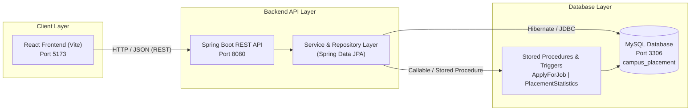

# Campus Placement Management System

A full-stack enterprise campus placement management platform built with **Spring Boot**, **React (Vite)**, and **MySQL**. The system streamlines the university recruitment lifecycle by centralizing student profiles, corporate partner directories, job postings, eligibility-checked job applications, interview rounds, placement records, and departmental placement statistics.

---

## 🚀 Live Demo

- 🌐 **Live Website:** https://placement-management-system-kappa.vercel.app/ 

## Architecture Overview



---

## Features

- **Students Directory**: Centralized student profiles with department mapping, graduation year, CGPA, active backlog tracking, and real-time placement status indicators (`PLACED` / `NOT_PLACED`).
- **Corporate Partner Management**: Company listings with industry classifications, headquarters location, corporate website links, and associated job openings.
- **Job Opportunities & Drives**: Job postings with formatted annual compensation packages (LPA), minimum CGPA criteria, maximum allowable backlogs, and active vs. expired deadline badges.
- **Automated Eligibility Checks**: Interactive job application workflow backed by a MySQL stored procedure that validates student existence, unplaced status, deadlines, CGPA eligibility, backlog limits, and duplicate applications.
- **Interview Scheduling**: Multi-round interview tracking (`Technical`, `HR`, `Aptitude`, `Managerial`) with date tracking, upcoming vs. completed filters, and round outcome badges (`Passed`, `Pending`, `Failed`).
- **Placement Outcomes**: Verified recruitment offers with salary package recording and onboarding dates, integrated with an automatic database trigger that updates candidate placement status upon offer insertion.
- **Placement Statistics & Analytics**: Department-level placement metrics calculated directly via stored procedures, featuring dynamic visualizations (ratio donut charts and comparative multi-department bar charts).
- **Light & Dark Themes**: Persistent theme engine with a floating toggle, support for system color schemes (`prefers-color-scheme`), and responsive layouts across desktop, tablet, and mobile viewports.

---

## Technology Stack

| Layer | Technologies |
|---|---|
| **Frontend** | React 19, Vite, React Router 7, Recharts, Lucide React, Custom CSS Design System |
| **Backend** | Spring Boot 4.x / 3.x, Java 17, Spring Data JPA, Spring Web MVC, Jakarta Validation |
| **Database** | MySQL 8.0+ (InnoDB, Stored Procedures, Triggers, Views) |
| **Build & Tooling** | Maven Wrapper (`mvnw`), npm, Node.js |

---

## Project Structure

```text
placement-management-system/
├── backend/
│   ├── mvnw / mvnw.cmd              # Maven wrapper scripts
│   ├── pom.xml                      # Spring Boot dependencies and Maven plugins
│   └── src/
│       └── main/
│           ├── java/com/example/placement_management_system/
│           │   ├── config/          # CORS configuration
│           │   ├── controller/      # REST API controllers
│           │   ├── entity/          # JPA entity models
│           │   ├── exception/       # Global exception handling
│           │   ├── repository/      # Spring Data JPA repositories
│           │   └── service/         # Business logic & procedure callers
│           └── resources/
│               └── application.properties # Application configuration template
├── database/
│   ├── schema.sql                   # Database and table definitions
│   ├── data.sql                     # Seed records for all entities
│   ├── procedures_triggers.sql      # Stored procedures & validation triggers
│   └── queries.sql                  # Verification and reporting queries
├── docs/
│   ├── ER_Diagram_Placement_System.png # Entity-Relationship diagram
│   ├── ER_to_Relational_Mapping.md  # Relational schema mapping documentation
│   ├── Project_Requirements.md      # Functional requirements specification
│   └── database_requirements.md     # Relational database specifications
├── frontend/
│   ├── index.html                   # HTML entry point with Inter typography
│   ├── package.json                 # Frontend dependencies and scripts
│   ├── vite.config.js               # Vite build configuration
│   └── src/
│       ├── api/                     # Centralized API service layer
│       ├── components/              # Reusable UI components & form controls
│       ├── contexts/                # Theme and Toast notification contexts
│       ├── layouts/                 # AppLayout, Sidebar, TopHeader
│       ├── pages/                   # Feature pages (Dashboard, Students, Jobs, etc.)
│       ├── styles/                  # CSS tokens, base rules, layout & components
│       └── utils/                   # Currency (INR/LPA) and date formatters
├── GIT_COMMIT_PLAN.md               # Logical Conventional Commit migration guide
└── README.md
```

---

## Prerequisites

Before running the application locally, ensure you have installed:

- **Java Development Kit (JDK)**: Version 17 or higher
- **Node.js**: Version 18.0.0 or higher (with **npm**)
- **MySQL Server**: Version 8.0 or higher
- **Git**: For version control

---

## Database Setup

Execute the SQL scripts in the following sequential order using the MySQL command-line client or MySQL Workbench:

### 1. Initialize Schema
Creates the database `campus_placement` along with the core relational tables (`department`, `student`, `company`, `job`, `application`, `interview`, `placement`):

```bash
mysql -u root -p < database/schema.sql
```

### 2. Populate Seed Data
Loads initial departments, corporate partners, student profiles, job postings, applications, interviews, and placements:

```bash
mysql -u root -p < database/data.sql
```

### 3. Install Stored Procedures and Triggers
Registers database-level logic:

```bash
mysql -u root -p < database/procedures_triggers.sql
```

*(Optional)* Run analytical and verification queries:
```bash
mysql -u root -p < database/queries.sql
```

---

## Backend Setup (Spring Boot)

### 1. Configure Database Connection

Open `backend/src/main/resources/application.properties` and configure your local MySQL credentials:

```properties
spring.application.name=placement-management-system

# Database Connection
spring.datasource.url=jdbc:mysql://localhost:3306/campus_placement?useSSL=false&serverTimezone=UTC
spring.datasource.username=root
spring.datasource.password=your_mysql_password

# Hibernate Configuration
spring.jpa.hibernate.ddl-auto=none
spring.jpa.show-sql=true
spring.jpa.properties.hibernate.format_sql=true
```

> **Security Note:** Never commit plain-text production passwords to source control. Alternatively, supply credentials via environment variables:
> `SPRING_DATASOURCE_USERNAME` and `SPRING_DATASOURCE_PASSWORD`.

### 2. Build and Run the Backend

Navigate to the `backend/` directory and use the Maven Wrapper:

**On Linux/macOS:**
```bash
cd backend
./mvnw clean install
./mvnw spring-boot:run
```

**On Windows:**
```powershell
cd backend
.\mvnw.cmd clean install
.\mvnw.cmd spring-boot:run
```

The Spring Boot backend will start at **`http://localhost:8080`**.

---

## Frontend Setup (React + Vite)

### 1. Install Dependencies

Navigate to the `frontend/` directory and install the required npm packages:

```bash
cd frontend
npm install
```

### 2. Run the Development Server

Start the local Vite development server:

```bash
npm run dev
```

The frontend will run at **`http://localhost:5173`**.

### 3. Production Build

To validate or generate the optimized production bundle:

```bash
npm run build
```

---

## REST API Reference

All REST endpoints operate under the base URL `http://localhost:8080/api`.

### Entity Management Endpoints

| Method | Endpoint | Description |
|---|---|---|
| `GET` | `/api/departments` | Retrieve all academic departments |
| `GET` | `/api/departments/{id}` | Retrieve a specific department by ID |
| `POST` | `/api/departments` | Create a new academic department |
| `DELETE` | `/api/departments/{id}` | Delete a department by ID |
| `GET` | `/api/students` | Retrieve all students |
| `GET` | `/api/students/{id}` | Retrieve a specific student by ID |
| `POST` | `/api/students` | Register a new student |
| `DELETE` | `/api/students/{id}` | Delete a student by ID |
| `GET` | `/api/companies` | Retrieve all corporate partners |
| `GET` | `/api/companies/{id}` | Retrieve a company by ID |
| `POST` | `/api/companies` | Add a new hiring partner |
| `DELETE` | `/api/companies/{id}` | Delete a company by ID |
| `GET` | `/api/jobs` | Retrieve all job openings |
| `GET` | `/api/jobs/{id}` | Retrieve a job by ID |
| `POST` | `/api/jobs` | Publish a new job opening |
| `DELETE` | `/api/jobs/{id}` | Delete a job by ID |
| `GET` | `/api/applications` | Retrieve all job applications |
| `GET` | `/api/applications/{id}` | Retrieve an application by ID |
| `POST` | `/api/applications` | Record a manual job application |
| `DELETE` | `/api/applications/{id}` | Delete an application by ID |
| `GET` | `/api/interviews` | Retrieve all interview rounds |
| `GET` | `/api/interviews/{id}` | Retrieve an interview by ID |
| `POST` | `/api/interviews` | Schedule an interview round |
| `DELETE` | `/api/interviews/{id}` | Delete an interview round by ID |
| `GET` | `/api/placements` | Retrieve all verified placement outcomes |
| `GET` | `/api/placements/{id}` | Retrieve a placement record by ID |
| `POST` | `/api/placements` | Record a new placement outcome |
| `DELETE` | `/api/placements/{id}` | Delete a placement record by ID |

### Stored Procedure Endpoints

| Method | Endpoint | Query Parameters | Description |
|---|---|---|---|
| `POST` | `/api/procedures/apply` | `studentId={id}&jobId={id}` | Invokes `ApplyForJob` stored procedure to validate student eligibility and submit application |
| `GET` | `/api/procedures/placement-statistics` | `departmentId={id}` | Invokes `PlacementStatistics` stored procedure to calculate department placement metrics |

---

## Database Logic

### Stored Procedures

1. **`ApplyForJob(IN p_student_id INT, IN p_job_id INT)`**
   Performs pre-application validation checks before creating an application record:
   - Verifies the student exists in the database.
   - Ensures the student is not already marked as `PLACED`.
   - Validates that the current date does not exceed the job's application deadline.
   - Enforces the minimum CGPA requirement (`student.cgpa >= job.min_cgpa`).
   - Enforces the maximum allowable backlogs (`student.backlogs <= job.max_backlogs`).
   - Checks that the student has not already applied for the specified job.
   - Generates the next application ID and inserts the application with status `'APPLIED'` and the current date.

2. **`PlacementStatistics(IN p_department_id INT)`**
   Aggregates placement metrics for a specific academic department:
   - Queries `department` with `LEFT JOIN` on `student` and `placement`.
   - Returns `department_name`, `total_students`, `students_placed`, and calculated `placement_percentage`.

### Triggers

1. **`prevent_late_application`**
   - **Timing**: `BEFORE INSERT ON application`
   - **Behavior**: Compares `CURDATE()` against the target job's `deadline`. If the current date is after the deadline, it raises SQL state `'45000'` with the message `'Application deadline has passed'`.

2. **`update_student_placement_status`**
   - **Timing**: `AFTER INSERT ON placement`
   - **Behavior**: Automatically updates `student.placement_status = 'PLACED'` for the corresponding `student_id` whenever a new placement record is inserted.

---

## Screenshots

| View | Description |
|---|---|
| **Dashboard** | Overview cards with real metrics, application status chart, department distribution donut chart, and recent activity feeds. |
| **Students Directory** | Tabular candidate list with CGPA color indicators, department filters, placement status badges, and details modal. |
| **Corporate Partners** | Industry-tagged organization cards with headquarters locations and active job counts. |
| **Job Opportunities** | Job listings with CTC package formatting (LPA), active/expired deadline badges, and the interactive Apply action. |
| **Placement Statistics** | Department selector displaying metrics from the `PlacementStatistics` procedure alongside comparative charts. |

*(Refer to `docs/ER_Diagram_Placement_System.png` for the database entity relationship diagram).*

---

## Troubleshooting

| Issue | Cause | Solution |
|---|---|---|
| **`CommunicationsException: Communications link failure`** | MySQL server is stopped or port `3306` is inaccessible. | Verify that MySQL service is running (`systemctl status mysql` or Windows Services) and listening on port `3306`. |
| **`Access denied for user 'root'@'localhost'`** | Incorrect database password in `application.properties`. | Update `spring.datasource.password` with your actual MySQL password. |
| **`Port 8080 already in use`** | Another process is occupying port `8080`. | Terminate the occupying process or change the port via `server.port=8081` in `application.properties`. |
| **`CORS Policy: No 'Access-Control-Allow-Origin' header`** | Frontend running on an origin not permitted by backend. | The backend config (`CorsConfig.java`) permits `http://localhost:5173`. Ensure your frontend server runs on port `5173`. |
| **`Failed to resolve import / module not found`** | Incomplete npm package installation. | Run `npm install` inside the `frontend/` directory to ensure all dependencies are installed. |

---

## Security & Best Practices

- **Credential Isolation**: Local database credentials should remain private. The repository's `.gitignore` excludes `backend/src/main/resources/application.properties` and local build outputs.
- **CORS Configuration**: In production, restrict the allowed origins in `CorsConfig.java` to your designated production domain instead of localhost.
- **Input Validation**: Critical eligibility rules are enforced directly at the database layer via stored procedures and triggers to guarantee data integrity.

---

## Future Improvements

- [ ] Role-Based Access Control (RBAC) with Spring Security and JWT authentication for Students, Placement Officers, and Recruiters.
- [ ] Student resume file upload and cloud storage integration (e.g., AWS S3).
- [ ] Automated email notifications for shortlisted candidates and upcoming interview rounds.
- [ ] Export functionality for placement audit reports in CSV and PDF formats.
- [ ] Student-facing self-service portal for viewing eligible drives and application history.

---

