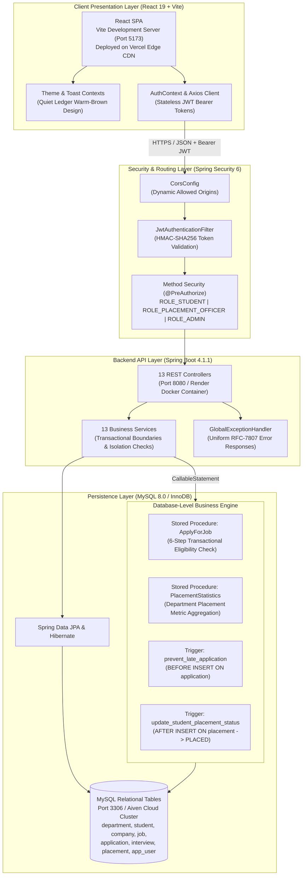

# Campus Placement Management System (CPMS)

[](https://www.oracle.com/java/technologies/javase/jdk17-archive-downloads.html)
[](https://spring.io/projects/spring-boot)
[](https://react.dev/)
[](https://vite.dev/)
[](https://www.mysql.com/)
[](https://spring.io/projects/spring-security)
[](https://junit.org/)
[](https://opensource.org/licenses/MIT)
[](https://placement-management-system-kappa.vercel.app/)

A robust, enterprise-grade full-stack campus placement management platform built with **Spring Boot**, **React (Vite)**, and **MySQL**. The system digitizes and automates the higher-education campus recruitment lifecycle—centralizing student academic rosters, corporate recruiting partners, campus hiring drives, stored-procedure-backed eligibility verification, multi-round interview pipelines, verified recruitment offers, and real-time accreditation placement statistics with CSV audit reporting.

---

## 🚀 Live Demo & Production Deployment

The application is deployed live and fully functional in cloud production:

- 🌐 **Live Web Application:** [https://placement-management-system-kappa.vercel.app/](https://placement-management-system-kappa.vercel.app/)

> [!NOTE]
> **Cloud Backend Cold Starts**: The backend is hosted on a Render free-tier container web service which spins down during inactivity. Initial requests after a period of dormancy may experience a 30–60 second spin-up delay while the container boots. The frontend client automatically displays a gentle connection notification during this initial wake-up.

### Instant Demo Credentials

For quick evaluation without manual registration, the login screen includes **single-click demo buttons** with pre-seeded data and destructive-action protection:

| Persona | Single-Click Button | Email Address | Password | Privileges & Scope |
| :--- | :--- | :--- | :--- | :--- |
| **Demo Student** | `Try Student Demo` | `demo.student@campushire.edu` | `DemoStudent@2026` | Rohan Verma (CSE, CGPA 8.85, 0 backlogs). Student portal: personal dashboard, eligible job drives, one-click eligibility checks, personal application tracker, multi-round interview schedule, and placement offer. |
| **Demo Officer** | `Try Officer Demo` | `demo.officer@campushire.edu` | `DemoOfficer@2026` | Full placement cell operations: student roster, soft-archiving, corporate partner directory, drive publishing, application progression, interview round scoring, offer generation, and analytical reports with CSV export. *(Deletion guarded in demo mode)* |
| **System Admin** | *(Manual Login)* | `admin@university.edu` *(or configured email)* | `AdminPass@2026` | Complete placement management + dedicated Officer Account Governance (`/officers`) for provisioning, activating, disabling, and resetting officer credentials. |

---

## 🏛️ System Architecture

The application adopts a decoupled, modern three-tier client-server architecture with database-enforced relational integrity and stateless JWT security:



---

## ✨ Key Features & Portals

### 👨‍🎓 1. Student Self-Service Portal (`ROLE_STUDENT`)
- **Personalized Candidate Dashboard**: Real-time summary cards displaying submitted applications, upcoming interview rounds, active drives, and finalized placement status.
- **Job Opportunities & Live Eligibility Verification**: Browse open recruitment drives with formatted compensation packages (in LPA), academic CGPA thresholds, allowable backlogs, and deadline badges.
- **One-Click Stored-Procedure Application**: Click `Apply Now` to invoke the MySQL stored procedure `ApplyForJob`. Immediate, transparent feedback is displayed if criteria (CGPA cutoff, backlog cap, deadline, duplicate submission) are not met.
- **Dedicated Application Tracking (`/my-applications`)**: Real-time lifecycle badges (`APPLIED`, `SHORTLISTED`, `SELECTED`, `REJECTED`) for all submissions.
- **Interview Pipeline Monitor (`/my-interviews`)**: Chronological interview round schedule (`Technical`, `HR`, `Aptitude`, `Managerial`) with round outcome indicators (`Pending`, `Passed`, `Failed`).
- **Verified Placement Offer (`/my-placement`)**: Official placement record showing hiring company, annual package, and scheduled onboarding date.
- **Data Isolation Guarantee**: Strict identity filtering ensures students can only inspect their own records; cross-candidate inspection attempts return HTTP 403 Forbidden.

### 💼 2. Placement Officer Management Console (`ROLE_PLACEMENT_OFFICER`)
- **Academic Student Directory**: Full student roster with department filtering, graduation year tracking, CGPA color highlights, active backlogs, and real-time placement status.
- **Safe Student Archiving**: Soft-archive candidates (`is_archived = TRUE`) to deactivate accounts while preserving all historical applications, interviews, and offer records for institutional accreditation.
- **Department Management**: Academic department catalog with student reference counts and safe deletion protection.
- **Corporate Partner Registry**: Company directory with industry classifications, headquarters locations, company URLs, and active job drives.
- **Campus Drive Publishing**: Create and manage job postings with package specifications (LPA), minimum CGPA cutoffs, maximum allowable backlogs, and application deadlines.
- **Application Lifecycle Progression**: Transition candidates across recruitment stages (`APPLIED` → `SHORTLISTED` → `SELECTED` / `REJECTED`) with integrity guards preventing changes to finalized candidates.
- **Multi-Round Interview Scheduling**: Schedule multi-round interviews with automated candidate lookup, round types, dates, and outcome management (`Passed`, `Pending`, `Failed`).
- **Verified Placement Recording**: Record finalized hiring offers. A database trigger immediately transitions the student's status to `PLACED`.
- **Departmental Analytics**: Instant execution of the `PlacementStatistics` stored procedure, visualized via interactive Recharts donut and comparative multi-department bar charts.
- **Accreditation Placement Reports with CSV Export**:
  - *Unapplied Eligible Students Report*: Identifies active candidates who have not yet applied to any campus drive.
  - *Recruiter Applicant Volume Rankings*: Ranks corporate partners and job drives by candidate interest.
  - *Active Interview Pipeline*: Roster of candidates progressing through active interview rounds.
  - *One-Click CSV Export*: Download audit data directly for NAAC / NBA accreditation reviews.

### 🛡️ 3. Administrator Governance Portal (`ROLE_ADMIN`)
- **Officer Account Provisioning (`/officers`)**: Institutional IT administrators can provision official Placement Officer accounts.
- **Credential Governance & Security Controls**: Enable or disable officer access and trigger administrator password resets.
- **Defense-in-Depth Self-Protection**: Security guards prevent administrators from disabling their own account or demoting their own credentials.

### 🎨 4. "Quiet Ledger" UI/UX Design System
- **Warm-Brown Editorial Aesthetic**: Inspired by distraction-free professional tools, built with a warm ivory canvas (`#FAF7F2`), walnut/cocoa brand primary (`#743F1D`), caramel accents, and charcoal typography.
- **Universal Light & Dark Modes**: Complete theme engine with persistent `localStorage` synchronization, system color-scheme detection, and a floating toggle button.
- **Responsive Mobile Layout**: Tabular grids on desktop smoothly transform into stacked, touch-friendly 44px mobile data cards on tablet and mobile viewports.

---

## 🛠️ Technology Stack

| Layer | Component | Version | Description |
| :--- | :--- | :--- | :--- |
| **Frontend** | React | `19.2.8` | Component-based UI library with functional components & hooks |
| | Vite | `8.3.0` | Ultra-fast next-generation frontend build tooling and HMR |
| | React Router DOM | `7.18.4` | Client-side routing, protected routes, and role-based redirects |
| | Recharts | `3.10.1` | Declarative SVG data visualization charts |
| | Lucide React | `1.55.0` | Clean, modern iconography |
| | Custom CSS | — | "Quiet Ledger" design system (CSS custom properties, zero external heavy UI frameworks) |
| **Backend** | Java | `17 LTS` | Core programming language (OpenJDK 17) |
| | Spring Boot | `4.1.1` | Enterprise application framework |
| | Spring Web MVC | — | RESTful controller architecture |
| | Spring Data JPA | — | Hibernate object-relational mapping repository layer |
| | Spring Security 6 | — | Stateless security filter chain, role-based method authorization |
| | JJWT (io.jsonwebtoken)| `0.12.6` | HMAC-SHA256 stateless JWT generation, parsing, and validation |
| | Jakarta Validation | — | Server-side request payload validation (`@Valid`, `@NotNull`, `@Email`) |
| **Database** | MySQL | `8.0+` | Relational database management system with InnoDB storage engine |
| | Stored Procedures | — | Transactional database-level business logic (`ApplyForJob`, `PlacementStatistics`) |
| | Database Triggers | — | Automated data validation and placement status updates |
| **Testing** | JUnit 5 & Mockito | — | Unit testing and service layer isolation |
| | H2 Database | — | In-memory relational database (`MODE=MySQL`) for automated integration tests |
| **Cloud Hosting** | Vercel | — | Global Edge CDN hosting for React SPA bundle |
| | Render | — | Dockerized Linux Alpine container service for Spring Boot backend |
| | Aiven for MySQL | `8.0+` | High-availability cloud-managed MySQL cluster with TLS/SSL |

---

## 📁 Project Directory Structure

```text
placement-management-system/
├── backend/                                   # Spring Boot REST API
│   ├── Dockerfile                             # Multi-stage production container build
│   ├── pom.xml                                # Maven dependencies & plugins
│   ├── mvnw / mvnw.cmd                        # Cross-platform Maven wrapper scripts
│   └── src/
│       ├── main/
│       │   ├── java/com/example/placement_management_system/
│       │   │   ├── PlacementManagementSystemApplication.java # Application main entry point
│       │   │   ├── config/                    # Security, CORS, Demo & Admin initializers
│       │   │   ├── controller/                # 13 REST API controllers
│       │   │   ├── dto/                       # Request/Response DTOs & analytical projections
│       │   │   ├── entity/                    # 9 JPA entity models (Student, Job, AppUser, etc.)
│       │   │   ├── exception/                 # Global exception handler & custom exceptions
│       │   │   ├── repository/                # 10 Spring Data JPA repositories & procedure callers
│       │   │   ├── security/                  # JWT filter, UserDetailsService & AccessDenied handlers
│       │   │   └── service/                   # 13 transactional business services
│       │   └── resources/
│       │       ├── application.properties     # Production & local configuration template
│       │       └── application.properties.example # Documented configuration blueprint
│       └── test/                              # 152 automated integration & unit tests
│           ├── java/com/example/placement_management_system/ # Test classes
│           └── resources/application-test.properties        # In-memory H2 MySQL test profile
├── database/                                  # Sequential MySQL database scripts
│   ├── schema.sql                             # 1. Base database & core relational tables
│   ├── data.sql                               # 2. Comprehensive initial seed records
│   ├── procedures_triggers.sql                # 3. Database stored procedures & triggers
│   ├── auth_schema.sql                        # 4. Authentication schema (app_user table & indexes)
│   ├── migration_student_archive.sql          # 5. Soft-archive column & updated ApplyForJob SP
│   └── queries.sql                            # Verification & reporting analytical queries
├── docs/                                      # Project documentation & architectural assets
│   ├── ER_Diagram_Placement_System.png        # Complete visual Entity-Relationship diagram
│   ├── ER_to_Relational_Mapping.md            # Detailed schema mapping documentation
│   ├── Project_Requirements.md                # Functional requirements specification
│   └── database_requirements.md               # Relational database specifications
├── frontend/                                  # React 19 + Vite Single Page Application
│   ├── index.html                             # Web application entry point
│   ├── package.json                           # Frontend dependencies & npm scripts
│   ├── vite.config.js                         # Vite build configuration
│   ├── vercel.json                            # Vercel SPA routing rewrites
│   ├── .env.example                           # Frontend environment variables template
│   └── src/
│       ├── api/                               # Modular API client modules (students, jobs, etc.)
│       ├── components/                        # Reusable UI controls, cards, modals, layout
│       ├── contexts/                          # ThemeContext, ToastContext, AuthContext
│       ├── pages/                             # 15 feature & portal pages (Student & Officer)
│       ├── styles/                            # CSS variables, layout, components, and base styling
│       └── utils/                             # INR / LPA currency and date formatters
├── PROJECT_EXPLANATION.md                     # Comprehensive viva defense & architectural specification
└── README.md                                  # Primary project documentation
```

---

## 💻 Step-by-Step Localhost Setup Guide

Follow these sequential steps to run the complete stack (**MySQL + Spring Boot + React**) on your local machine.

### 📋 Prerequisites

Before starting, verify you have the required runtimes installed:

| Tool | Minimum Version | Verification Command | Download Link |
| :--- | :--- | :--- | :--- |
| **Java JDK** | `17 LTS` or higher | `java -version` | [Adoptium Eclipse Temurin](https://adoptium.net/) |
| **Node.js & npm** | `Node 18.0.0+` / `npm 9+` | `node -v` and `npm -v` | [Node.js Official](https://nodejs.org/) |
| **MySQL Server** | `8.0` or higher | `mysql --version` | [MySQL Community Server](https://dev.mysql.com/downloads/mysql/) |
| **Git** | `2.x` | `git --version` | [Git SCM](https://git-scm.com/) |

---

### Step 1: Clone the Repository

```bash
git clone https://github.com/manikandanmp27/placement-management-system.git
cd placement-management-system
```

---

### Step 2: Initialize the MySQL Database

The database setup requires executing **five SQL scripts in strict sequential order** to build the tables, populate seed data, register stored procedures and triggers, configure user authentication, and apply soft-archival migrations.

> [!IMPORTANT]
> Ensure your local MySQL server is running on port `3306`. Replace `root` and enter your MySQL root password when prompted.

#### Option A: Command-Line Client (Terminal)

**On Windows (PowerShell):**
```powershell
Get-Content database/schema.sql | mysql -u root -p
Get-Content database/data.sql | mysql -u root -p
Get-Content database/procedures_triggers.sql | mysql -u root -p
Get-Content database/auth_schema.sql | mysql -u root -p
Get-Content database/migration_student_archive.sql | mysql -u root -p
```

**On Linux / macOS (Bash):**
```bash
mysql -u root -p < database/schema.sql
mysql -u root -p < database/data.sql
mysql -u root -p < database/procedures_triggers.sql
mysql -u root -p < database/auth_schema.sql
mysql -u root -p < database/migration_student_archive.sql
```

#### Option B: MySQL Workbench or GUI Client
1. Open MySQL Workbench and connect to your local MySQL instance.
2. Open and execute (`Ctrl + Shift + Enter`) the files in order:
   - `database/schema.sql` (Creates `campus_placement` database and core tables)
   - `database/data.sql` (Inserts seed records for departments, students, companies, jobs, etc.)
   - `database/procedures_triggers.sql` (Creates stored procedures and triggers)
   - `database/auth_schema.sql` (Creates `app_user` authentication table and indexes)
   - `database/migration_student_archive.sql` (Adds `is_archived` column and updates procedure)

*(Optional verification):*
```sql
USE campus_placement;
SHOW TABLES;
-- Expected tables: app_user, application, company, department, interview, job, placement, student
```

---

### Step 3: Configure and Start the Backend (Spring Boot)

#### 1. Configure Database Connection

Open `backend/src/main/resources/application.properties`. You can either edit the file directly or supply environment variables:

```properties
spring.application.name=placement-management-system
server.port=8080

# Database Connection (Adjust password to match your local MySQL root password)
spring.datasource.url=jdbc:mysql://localhost:3306/campus_placement?useSSL=false&serverTimezone=UTC&allowPublicKeyRetrieval=true
spring.datasource.username=root
spring.datasource.password=your_mysql_password
spring.datasource.driver-class-name=com.mysql.cj.jdbc.Driver

# Hibernate Configuration
spring.jpa.hibernate.ddl-auto=none
spring.jpa.show-sql=false

# Allowed Frontend Origins (CORS)
cors.allowed-origins=http://localhost:5173,http://localhost:5174,http://127.0.0.1:5173

# JWT Security Configuration (256-bit base64 secret)
jwt.secret=E11Q8RsICy7pDF76SMh93CH+kqLEs/Bvz1sz3l66ejc=
jwt.expiration-ms=86400000

# Initial Administrator Bootstrap Credentials (Auto-created on first startup if no admin exists)
app.bootstrap.admin.email=admin@university.edu
app.bootstrap.admin.password=AdminPass@2026

# Demo Accounts Configuration (Auto-creates demo accounts on startup)
app.demo.enabled=true
app.demo.student.email=demo.student@campushire.edu
app.demo.student.password=DemoStudent@2026
app.demo.officer.email=demo.officer@campushire.edu
app.demo.officer.password=DemoOfficer@2026
```

> [!TIP]
> You can also run without modifying `application.properties` by passing environment variables:
> - **Windows (PowerShell):** `$env:DB_PASSWORD="your_mysql_password"; .\mvnw.cmd spring-boot:run`
> - **Linux/macOS (Bash):** `DB_PASSWORD="your_mysql_password" ./mvnw spring-boot:run`

#### 2. Run the Backend Application

Navigate to the `backend/` folder and execute the Maven wrapper:

**On Windows:**
```powershell
cd backend
.\mvnw.cmd spring-boot:run
```

**On Linux / macOS:**
```bash
cd backend
chmod +x mvnw
./mvnw spring-boot:run
```

When started successfully, the Spring Boot API will listen on **`http://localhost:8080`**.

#### 3. Verify Backend Health

Open your browser or terminal to check the health endpoint:
```bash
curl http://localhost:8080/api/health
```
**Expected Response:**
```json
{"status":"UP"}
```

---

### Step 4: Configure and Start the Frontend (React + Vite)

#### 1. Navigate to Frontend & Install Dependencies

Open a **new terminal window** and run:

```bash
cd frontend
npm install
```

#### 2. Configure Frontend Environment (`.env`)

Create a `.env` file in the `frontend/` directory (or copy from `.env.example`):

**On Windows (PowerShell):**
```powershell
Copy-Item .env.example .env
```

**On Linux / macOS:**
```bash
cp .env.example .env
```

Ensure `.env` contains:
```env
VITE_API_BASE_URL=http://localhost:8080/api
```

#### 3. Start the Development Server

```bash
npm run dev
```

The frontend will boot in milliseconds and will be accessible at:
👉 **`http://localhost:5173`**

---

### Step 5: Test the System Locally

Navigate to **`http://localhost:5173`** in your browser. You can immediately log in using any of the three pre-configured accounts:

```text
┌─────────────────────────────────────────────────────────────────────────────┐
│                           AVAILABLE LOCAL ACCOUNTS                          │
├────────────────────────┬───────────────────────────────┬────────────────────┤
│ Role                   │ Email                         │ Password           │
├────────────────────────┼───────────────────────────────┼────────────────────┤
│ 👨‍🎓 Demo Student       │ demo.student@campushire.edu   │ DemoStudent@2026   │
│ 💼 Demo Officer        │ demo.officer@campushire.edu   │ DemoOfficer@2026   │
│ 🛡️ System Admin        │ admin@university.edu          │ AdminPass@2026     │
└────────────────────────┴───────────────────────────────┴────────────────────┘
```

> [!TIP]
> On the login page, you can also simply click the **"Try Student Demo"** or **"Try Officer Demo"** buttons to log in with a single click!

---

## 🗄️ Database Logic & Integrity Rules

The core business and eligibility constraints of the campus placement lifecycle are intentionally implemented and enforced within the MySQL database layer via stored procedures and triggers.

### Stored Procedure 1: `ApplyForJob`

```sql
CALL ApplyForJob(p_student_id, p_job_id);
```

Executes a transactional, atomic 6-stage eligibility verification before inserting an application:

1. **Student Existence Check**: Verifies that the candidate ID exists in `student`. If not, raises SQL state `'45000'` (*"Student does not exist"*).
2. **Soft-Archival Check**: Validates that `is_archived = FALSE`. Inactive or graduated candidates cannot apply (*"Archived students are not eligible to apply for jobs"*).
3. **Placement Status Check**: Confirms the student is not already marked as `PLACED` (*"Student is already placed"*).
4. **Deadline Verification**: Ensures `CURDATE() <= job.deadline` (*"Application deadline has passed"*).
5. **Academic CGPA Cutoff**: Verifies `student.cgpa >= job.min_cgpa` (*"Student does not meet CGPA requirement"*).
6. **Backlog Allowance**: Ensures active backlogs do not exceed allowable threshold `student.backlogs <= job.max_backlogs` (*"Student has too many backlogs"*).
7. **Duplicate Guard**: Checks if the student has already applied for this drive (*"Student has already applied for this job"*).

### Stored Procedure 2: `PlacementStatistics`

```sql
CALL PlacementStatistics(p_department_id);
```

Calculates real-time placement metrics for an academic department using a multi-table `LEFT JOIN` across `department`, `student`, and `placement`. Returns:
- `department_name`
- `total_students`
- `students_placed`
- `placement_percentage` (calculated as `ROUND((students_placed / total_students) * 100, 2)`)

### Database Triggers

1. **`prevent_late_application`**
   - **Timing**: `BEFORE INSERT ON application`
   - **Behavior**: Compares `CURDATE()` against the target job's deadline. If late, aborts the insert with `SIGNAL SQLSTATE '45000'` (*"Application deadline has passed"*).
2. **`update_student_placement_status`**
   - **Timing**: `AFTER INSERT ON placement`
   - **Behavior**: Automatically executes `UPDATE student SET placement_status = 'PLACED' WHERE student_id = NEW.student_id;`, keeping candidate statuses synchronized with zero application latency.

---

## 📡 REST API Reference

All backend endpoints are prefixed under `http://localhost:8080/api`.

### 1. Authentication & Session Endpoints
| Method | Endpoint | Access Role | Description |
| :--- | :--- | :--- | :--- |
| `POST` | `/api/auth/login` | Public | Authenticates credentials and returns JWT bearer token + user profile |
| `POST` | `/api/auth/demo-login` | Public | Single-click demo authentication (`ROLE_STUDENT` or `ROLE_PLACEMENT_OFFICER`) |
| `POST` | `/api/auth/register-student` | Public | Registers a student user account linked to an existing roster email |
| `GET` | `/api/auth/me` | Authenticated | Retrieves current authenticated session user details |

### 2. Administrator Governance (`ROLE_ADMIN`)
| Method | Endpoint | Access Role | Description |
| :--- | :--- | :--- | :--- |
| `GET` | `/api/admin/officers` | `ROLE_ADMIN` | Lists all provisioned Placement Officer accounts |
| `POST` | `/api/admin/officers` | `ROLE_ADMIN` | Provisions a new Placement Officer account |
| `PATCH` | `/api/admin/officers/{id}/status` | `ROLE_ADMIN` | Enables or disables an officer account (guarded against self-disable) |
| `POST` | `/api/admin/officers/{id}/reset-password` | `ROLE_ADMIN` | Resets an officer's password |

### 3. Students Management (`/api/students`)
| Method | Endpoint | Access Role | Description |
| :--- | :--- | :--- | :--- |
| `GET` | `/api/students` | Officer / Admin | Retrieves all students (supports `?includeArchived=true/false`) |
| `GET` | `/api/students/{id}` | Officer / Admin / Own Student | Retrieves individual student profile details |
| `POST` | `/api/students` | Officer / Admin | Registers a new student candidate into the roster |
| `PUT` | `/api/students/{id}` | Officer / Admin | Updates candidate profile details |
| `PATCH` | `/api/students/{id}/archive` | Officer / Admin | Soft-archives student (deactivates account while preserving history) |
| `PATCH` | `/api/students/{id}/restore` | Officer / Admin | Restores an archived student back to active roster status |
| `DELETE` | `/api/students/{id}` | Officer / Admin | Safely deletes an unreferenced candidate (blocked if applications/offers exist) |

### 4. Academic Departments (`/api/departments`)
| Method | Endpoint | Access Role | Description |
| :--- | :--- | :--- | :--- |
| `GET` | `/api/departments` | Authenticated | Retrieves list of all departments |
| `GET` | `/api/departments/{id}` | Authenticated | Retrieves department details by ID |
| `POST` | `/api/departments` | Officer / Admin | Adds a new academic department |
| `PUT` | `/api/departments/{id}` | Officer / Admin | Updates academic department name |
| `DELETE` | `/api/departments/{id}` | Officer / Admin | Deletes department (guarded against departments with enrolled students) |

### 5. Corporate Partners & Job Drives (`/api/companies`, `/api/jobs`)
| Method | Endpoint | Access Role | Description |
| :--- | :--- | :--- | :--- |
| `GET` | `/api/companies` | Authenticated | Retrieves corporate partner directory |
| `POST` | `/api/companies` | Officer / Admin | Registers a new corporate recruitment partner |
| `PUT` | `/api/companies/{id}` | Officer / Admin | Updates company profile and location |
| `DELETE` | `/api/companies/{id}` | Officer / Admin | Deletes hiring company (guarded against active drives) |
| `GET` | `/api/jobs` | Authenticated | Retrieves all campus recruitment drives |
| `POST` | `/api/jobs` | Officer / Admin | Publishes a new job drive with CGPA cutoffs and deadlines |
| `PUT` | `/api/jobs/{id}` | Officer / Admin | Updates job drive package or deadline |
| `DELETE` | `/api/jobs/{id}` | Officer / Admin | Removes job drive |

### 6. Application Progression & Interviews (`/api/applications`, `/api/interviews`)
| Method | Endpoint | Access Role | Description |
| :--- | :--- | :--- | :--- |
| `GET` | `/api/applications` | Officer / Admin / Own Student | Retrieves applications (students receive only their personal submissions) |
| `PATCH` | `/api/applications/{id}/status` | Officer / Admin | Updates stage (`APPLIED`, `SHORTLISTED`, `SELECTED`, `REJECTED`) |
| `GET` | `/api/interviews` | Officer / Admin / Own Student | Retrieves interviews (students receive only their scheduled rounds) |
| `POST` | `/api/interviews` | Officer / Admin | Schedules a multi-round interview for an applicant |
| `PATCH` | `/api/interviews/{id}/result`| Officer / Admin | Updates interview outcome (`Passed`, `Pending`, `Failed`) |

### 7. Placement Outcomes & Stored Procedures
| Method | Endpoint | Access Role | Description |
| :--- | :--- | :--- | :--- |
| `GET` | `/api/placements` | Officer / Admin / Own Student | Retrieves verified recruitment placements |
| `POST` | `/api/placements` | Officer / Admin | Records hiring offer (triggers automatic student status update to `PLACED`) |
| `POST` | `/api/procedures/apply` | Authenticated Student / Officer | Invokes MySQL stored procedure `ApplyForJob` |
| `GET` | `/api/procedures/placement-statistics` | Authenticated | Invokes MySQL stored procedure `PlacementStatistics` for a department |

### 8. Analytical Reports & Audit Module (`/api/reports`)
| Method | Endpoint | Access Role | Description |
| :--- | :--- | :--- | :--- |
| `GET` | `/api/reports/summary` | Officer / Admin | Returns high-level placement KPIs across the entire institution |
| `GET` | `/api/reports/unapplied-students` | Officer / Admin | Lists active students with 0 job applications |
| `GET` | `/api/reports/job-applicant-counts` | Officer / Admin | Ranks campus drives and companies by total applicant volume |
| `GET` | `/api/reports/students-in-interviews` | Officer / Admin | Roster of candidates actively progressing in interview rounds |

---

## 🧪 Automated Testing Suite

The repository features an exhaustive backend automated test suite executing against an in-memory **H2 database configured in MySQL compatibility mode** (`MODE=MySQL`):

```powershell
# Run the complete test suite locally
cd backend
.\mvnw.cmd test          # Windows
./mvnw test              # Linux / macOS
```

### Verified Test Results

```text
[INFO] -------------------------------------------------------
[INFO]  T E S T S
[INFO] -------------------------------------------------------
[INFO] Running com.example.placement_management_system.PlacementManagementSystemApplicationTests
[INFO] Tests run: 152, Failures: 0, Errors: 0, Skipped: 0
[INFO] 
[INFO] ------------------------------------------------------------------------
[INFO] BUILD SUCCESS
[INFO] ------------------------------------------------------------------------
[INFO] Total time:  48.724 s
```

### Test Suites Breakdown
1. **`JwtServiceTest` & `JwtStartupFailureTest` (16 tests)**: Validates HMAC-SHA256 signature verification, claims extraction, token expiration, and fail-fast startup protection on weak secrets.
2. **`SecurityFilterChainIntegrationTest` (13 tests)**: Tests public vs protected endpoint gating, CORS preflight headers, and 401/403 RFC-compliant JSON responses.
3. **`RoleAuthorizationIntegrationTest` (24 tests)**: Verifies the 3-role permission matrix across all business endpoints, confirming students are blocked from administrative mutations.
4. **`StudentDataIsolationIntegrationTest` (9 tests)**: Verifies that authenticated student callers cannot inspect or modify other candidates' applications or offers.
5. **`StudentArchiveIntegrationTest` (17 tests)**: Validates soft-archival state transitions, login deactivation, and safe deletion blocking.
6. **`OfficerManagementIntegrationTest` (17 tests)**: Validates admin officer provisioning, unique email validation, self-protection guards, and status disabling.
7. **`DepartmentManagementIntegrationTest` (19 tests)**: Validates department CRUD, duplicate name rejection, and student reference deletion protection.
8. **`ReportIntegrationTest` (12 tests)**: Validates unapplied student queries, job applicant volume rankings, and analytical projections.
9. **`DemoLoginIntegrationTest` & `AuthControllerTest` (17 tests)**: Tests single-click demo logins, role assignment, and validation checks.
10. **`AuthServiceTest` & `AdminBootstrapInitializerTest` (14 tests)**: Validates credential verification, student roster email pairing, and idempotent admin initialization.

---

## 🔧 Troubleshooting Guide

| Issue / Error Symptom | Root Cause | Verified Solution |
| :--- | :--- | :--- |
| **`CommunicationsException: Communications link failure`** | MySQL server is not running or listening on port 3306. | Start MySQL via Windows Services (`services.msc`) or terminal (`net start mysql` / `systemctl start mysql`). Verify port 3306 is open. |
| **`Access denied for user 'root'@'localhost'`** | Incorrect MySQL credentials in `application.properties`. | Update `spring.datasource.password` in `backend/src/main/resources/application.properties` with your actual MySQL password. |
| **`Table 'campus_placement.app_user' doesn't exist`** | `database/auth_schema.sql` was not executed. | Run `database/auth_schema.sql` to create the authentication table and indexes. |
| **`Unknown column 'is_archived' in 'field list'`** | `database/migration_student_archive.sql` was not executed. | Run `database/migration_student_archive.sql` in MySQL to add the soft-archival column. |
| **`JWT secret must be at least 256 bits`** | The `jwt.secret` property is missing or too short. | Ensure `jwt.secret` in `application.properties` is at least 32 bytes (e.g. `E11Q8RsICy7pDF76SMh93CH+kqLEs/Bvz1sz3l66ejc=`). |
| **`Port 8080 already in use`** | Another application (e.g., another Tomcat or web server) is occupying port 8080. | Stop the process or run Spring Boot on another port using `-Dserver.port=8081` or setting `server.port=8081` in `application.properties`. |
| **`Port 5173 already in use`** | A previous Vite instance is running. | Vite will automatically offer port `5174`. Update `cors.allowed-origins` in `application.properties` to allow port `5174`. |
| **`CORS error: No 'Access-Control-Allow-Origin' header`** | Frontend origin is not listed in backend CORS whitelist. | Add your frontend origin (e.g., `http://localhost:5173`) to `cors.allowed-origins` in `application.properties`. |
| **`Connecting to backend service... (Cloud wake-up)`** | Hosted Render backend is spinning up from idle state. | Allow 30–60 seconds for the free-tier container to initialize on initial request. |

---

## 👥 User Roles & Access Matrix

| Feature / Resource | Student (`ROLE_STUDENT`) | Placement Officer (`ROLE_PLACEMENT_OFFICER`) | Administrator (`ROLE_ADMIN`) |
| :--- | :---: | :---: | :---: |
| Browse Campus Job Drives | ✅ Read | ✅ Read | ✅ Read |
| Submit Job Applications (`ApplyForJob`) | ✅ Own Only | ✅ Management | ✅ Management |
| Track Applications Pipeline | ✅ Own Only | ✅ Full Access | ✅ Full Access |
| View Interview Rounds & Outcomes | ✅ Own Only | ✅ Manage & Grade | ✅ Manage & Grade |
| View Placement Offers & Package | ✅ Own Only | ✅ Record & Manage | ✅ Record & Manage |
| Student Roster & Academic Details | ❌ None | ✅ View, Edit, Archive | ✅ View, Edit, Archive |
| Corporate Partner Directory | ✅ View | ✅ Manage | ✅ Manage |
| Department Catalog | ✅ View | ✅ Manage | ✅ Manage |
| Placement Statistics (`PlacementStatistics`) | ✅ View | ✅ View & Analyze | ✅ View & Analyze |
| Audit Reports with CSV Export | ❌ None | ✅ View & Export | ✅ View & Export |
| Provision Placement Officer Accounts | ❌ None | ❌ None | ✅ Full Access (`/officers`) |

---

## 📄 License & Attribution

This project is licensed under the **MIT License** — see the [LICENSE](LICENSE) file for full details.

Developed for academic evaluation, university career departments, and enterprise placement automation. Contributions, feedback, and pull requests are welcomed!
